Every building a colony can raise, what it costs and what it does.

Buildings are how a colony grows from a few huts into a town. Most house a trade, where up to three colonists turn a raw good into a made one; the rest serve the whole colony: they store more, breed horses faster, teach, ring bells, make crosses or keep enemies out. How colonists work in them is on [[Colonies]].

## Lines of buildings

Most buildings come in lines. Each one in a line replaces the one before it, does the same work better and needs it built first: a Weaver's House becomes a Weaver's Shop and then a Textile Mill. Every new colony starts with the first building of seven lines: the Town Hall, the Carpenter's Shop and the five craft houses.

In a craft line the second building adds each worker's base amount again (a free colonist makes 6 instead of 3), and the third (the factory) makes half again as much as the second while using less raw material. Factories need Adam Smith in the Congress.

## Every building

Sprites are drawn in your colours in the game. Hammers and tools are what the building costs; colonists needed is the population the colony must have before it may start. A Town Hall is never built: every colony has one from the start.

<!-- table: buildings -->

| Sprite | Building | Hammers | Tools | Colonists needed | Also needs | What it does |
| :--- | :--- | :--- | :--- | :--- | :--- | :--- |
| 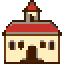 | Town Hall | 64 | 0 | 1 | - | Up to 3 statesmen ring liberty bells. The colony rings 1 a turn with nobody here. |
| 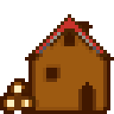 | Carpenter's Shop | 39 | 0 | 1 | - | Up to 3 carpenters turn lumber into hammers, one for one. |
| 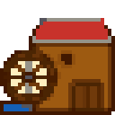 | Lumber Mill | 52 | 0 | 3 | - | Carpenters make twice as many hammers. |
| 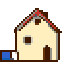 | Weaver's House | 64 | 0 | 1 | - | Up to 3 colonists turn cotton into cloth, one for one. |
| 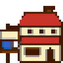 | Weaver's Shop | 64 | 20 | 1 | - | Each worker makes his base amount again on top: a free colonist 6 instead of 3, an expert 12 instead of 6. |
| 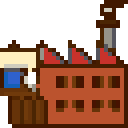 | Textile Mill | 160 | 100 | 8 | Adam Smith | Half again the output of the Weaver's Shop, using only 2 cotton for every 3 cloth. |
| 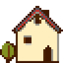 | Tobacconist's House | 64 | 0 | 1 | - | Up to 3 colonists turn tobacco into cigars, one for one. |
| 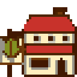 | Tobacconist's Shop | 64 | 20 | 1 | - | Each worker makes his base amount again on top: a free colonist 6 instead of 3, an expert 12 instead of 6. |
| 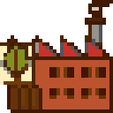 | Cigar Factory | 160 | 100 | 8 | Adam Smith | Half again the output of the Tobacconist's Shop, using only 2 tobacco for every 3 cigars. |
| 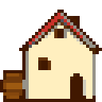 | Rum Distiller's House | 64 | 0 | 1 | - | Up to 3 colonists turn sugar into rum, one for one. |
| 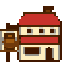 | Rum Distillery | 64 | 20 | 1 | - | Each worker makes his base amount again on top: a free colonist 6 instead of 3, an expert 12 instead of 6. |
| 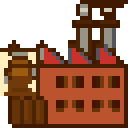 | Rum Factory | 160 | 100 | 8 | Adam Smith | Half again the output of the Rum Distillery, using only 2 sugar for every 3 rum. |
|  | Fur Trader's House | 56 | 0 | 1 | - | Up to 3 colonists turn furs into coats, one for one. |
| 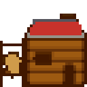 | Fur Trading Post | 56 | 20 | 1 | - | Each worker makes his base amount again on top: a free colonist 6 instead of 3, an expert 12 instead of 6. |
| 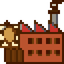 | Fur Factory | 160 | 100 | 6 | Adam Smith | Half again the output of the Fur Trading Post, using only 2 furs for every 3 coats. |
| 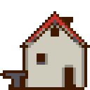 | Blacksmith's House | 64 | 0 | 1 | - | Up to 3 colonists turn ore into tools, one for one. |
| 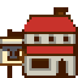 | Blacksmith's Shop | 64 | 20 | 1 | - | Each worker makes his base amount again on top: a free colonist 6 instead of 3, an expert 12 instead of 6. |
| 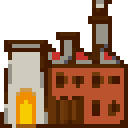 | Iron Works | 240 | 100 | 8 | Adam Smith | Half again the output of the Blacksmith's Shop, using only 2 ore for every 3 tools. |
| 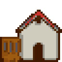 | Armory | 52 | 0 | 1 | - | Up to 3 colonists turn tools into muskets, one for one. Artillery can be built. |
| 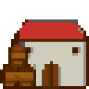 | Magazine | 120 | 50 | 8 | - | Each worker makes his base amount again on top: a free colonist 6 instead of 3, an expert 12 instead of 6. |
| 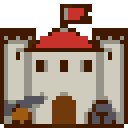 | Arsenal | 240 | 100 | 8 | Adam Smith | Half again the output of the Magazine, using only 2 tools for every 3 muskets. |
| 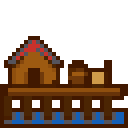 | Docks | 52 | 0 | 1 | water beside the colony | Colonists can fish on the colony's water squares. |
| 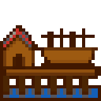 | Drydock | 80 | 50 | 4 | the open sea beside the colony | Damaged ships come here to be repaired, in half the time Europe takes. |
| 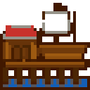 | Shipyard | 240 | 100 | 8 | the open sea beside the colony | Ships can be built: Caravel, Merchantman, Galleon, Privateer, Frigate. |
| 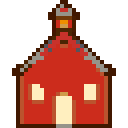 | Schoolhouse | 64 | 0 | 4 | - | Seats 1 teacher. An expert may teach here if his trade is taught at level 1. |
| 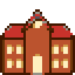 | College | 160 | 50 | 8 | - | Seats 2 teachers. An expert may teach here if his trade is taught at level 2 or below. |
| 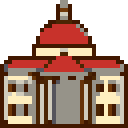 | University | 200 | 100 | 10 | - | Seats 3 teachers. An expert may teach here if his trade is taught at level 3 or below. |
| 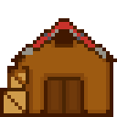 | Warehouse | 80 | 0 | 1 | - | The colony keeps 200 of each good instead of 100. |
| 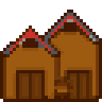 | Warehouse Expansion | 80 | 20 | 1 | - | The colony keeps 300 of each good. |
| 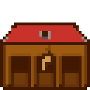 | Stable | 64 | 0 | 1 | - | A big herd breeds faster: up to 2 new horses for every 25 in the herd (or part of 25) instead of every 50, food and room allowing. |
|  | Custom House | 160 | 50 | 1 | Peter Stuyvesant | Sells the goods you choose without a ship: each turn, down to 50 once 100 are in store. |
| 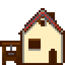 | Printing Press | 52 | 20 | 1 | - | Half again the colony's liberty bells. |
| 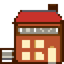 | Newspaper | 120 | 50 | 4 | - | Twice the colony's liberty bells, in place of the press's half again. |
| 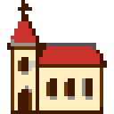 | Church | 64 | 0 | 3 | - | The colony makes 2 crosses a turn instead of 1, and up to 3 preachers make more. |
| 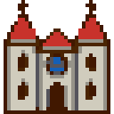 | Cathedral | 176 | 100 | 8 | - | The colony makes 3 crosses a turn, and each preacher makes twice as many. |
| 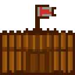 | Stockade | 64 | 0 | 3 | - | Defenders get +100% (a bare colony gives +50%). The colony can no longer drop below 3 colonists by choice, nor be abandoned. |
| 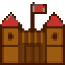 | Fort | 120 | 100 | 3 | - | Defenders get +150%. Fires on enemy ships beside the colony and costs them 2 thirds of a move. |
| 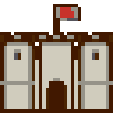 | Fortress | 320 | 200 | 8 | - | Defenders get +200%. Fires on enemy ships beside the colony twice as hard and stops them there. |

<!-- /table -->

Some buildings in the game's tables are never offered: the second and third Town Hall and the Capitol and its expansion. They are left out here.

## Construction

 A colony builds one thing at a time. Carpenters in the Carpenter's Shop turn lumber into hammers, and the hammers go into the colony's store every turn, whether or not anything is being built. Larger buildings also need tools, which must be in the warehouse when the hammers are complete. Look at the panel's **3 Construction** view to see the project and how far it has come.

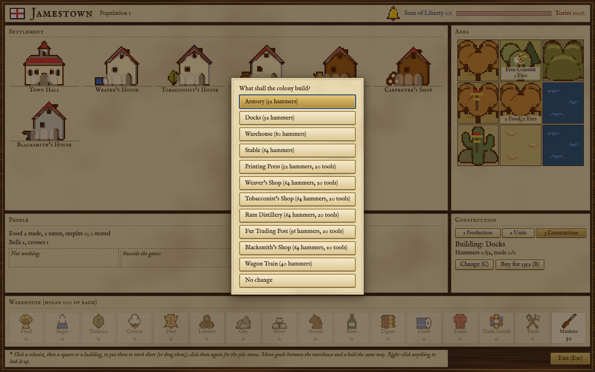

**Choosing the project.** Press **C**, or Change in the construction view, for the list of everything the colony can start now, with its hammers and tools. A building appears in the list once the colony has the colonists it needs and the building before it in its line, and only if the colony has the Founding Father or the coast it needs. The project under way stays in the list.

**Finishing.** At the end of the colony's turn, if the hammers have reached the cost and the tools are in the warehouse, the tools are used, the building goes up and the hammer store goes back to nothing; extra hammers are not kept. If the tools are missing you are told how many, and the hammers wait until the tools arrive. There is no queue: the finished project stays selected, so choose the next one. If you leave a finished building selected, the game reminds you that the colony already has it; if you leave a unit selected, the colony builds another.

**Buying the rest.** Press **B**, or the Buy button, to pay for whatever is still missing. The price is 13 gold for each hammer still to come, plus Europe's price of tools and 4 more for each tool missing. If no hammer at all has been put toward the project, the price doubles, so it pays to let the carpenters start first: the colony in the picture, with no hammers yet, is asked 1352 gold for Docks, twice 52 hammers at 13. Bought hammers and tools go into the store, and the project is finished at the end of the turn as usual.

### Units a colony can build

A colony can also build wagon trains, artillery and ships. A wagon train needs no building, but you may have only as many wagon trains as colonies.

<!-- table: buildable-units -->

| Sprite | Unit | Hammers | Tools | Needs |
| :--- | :--- | :--- | :--- | :--- |
| 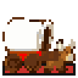 | Wagon Train | 40 | 0 | Fewer wagon trains than you have colonies |
|  | Artillery | 192 | 40 | Armory |
|  | Caravel | 128 | 40 | Shipyard |
| 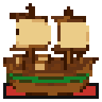 | Merchantman | 192 | 80 | Shipyard |
| 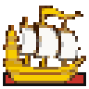 | Galleon | 320 | 100 | Shipyard |
| 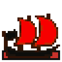 | Privateer | 256 | 120 | Shipyard |
| 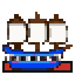 | Frigate | 512 | 200 | Shipyard |

<!-- /table -->

## Founding Fathers and buildings

Three Founding Fathers change what you can build (see [[Founding Fathers]]):

- **Adam Smith** allows the five factories (Textile Mill, Cigar Factory, Rum Factory, Fur Factory, Iron Works) and the Arsenal.
- **Peter Stuyvesant** allows the Custom House.
- **Sieur De La Salle** gives a Stockade free to every colony of three or more colonists when he joins, and to every colony that reaches three afterwards. A stockade cannot be taken down, so such a colony can no longer drop below three colonists by choice.

Three others raise what buildings make: Thomas Jefferson and Thomas Paine add to every colony's liberty bells, and William Penn makes every preacher half again as productive.
