Founding a colony, putting colonists to work, and what a colony makes.

A colony is where your people live and work. Colonists farm, fish, cut timber and mine on the squares around it, and work in its buildings to turn raw goods into goods worth more. Every bell and cross your people make comes from a colony, and so does every hammer that raises a building or a ship. The buildings themselves are on [[Buildings]].

## Founding a colony

Any colonist may found a colony, whatever he carries: a soldier, a pioneer or a scout founds one as well as a free colonist. Only an Indian convert cannot. Move him to the square you want and press **B** (or the Build button).

You may found on any land except Mountains, and not on a square next to another colony, yours or anyone's: there must be at least one empty square between two colonies. Once you have declared independence you can found no more. There may be 48 colonies in the whole game, and you may hold 38 of them; colonies you take in war do not count against you.

The game warns you, and lets you go ahead anyway, when the site has no way to the ocean. On the two easiest levels it also warns you when the land around is poor (fewer than four useful squares) or has no forest for lumber.

A new colony starts with a Town Hall, a Carpenter's Shop and the five craft houses (weaver, tobacconist, rum distiller, fur trader and blacksmith). Its warehouse is empty except for what the founder carried: a pioneer's leftover tools, the 50 muskets of a soldier or dragoon, the 50 horses of a scout or dragoon. It starts building Docks if it is on the sea, otherwise a Warehouse.

### The centre square

The colony's own square works by itself, without a colonist. It always gives food, and also the most of sugar, tobacco, cotton, furs, ore or silver it can give. Plowing the square and a food resource such as wheat or game raise the food; a river raises the second product; on the two easiest levels both are a little higher. Sons of Liberty raise both, but roads and experts do not. The square is not cleared, plowed or given a road by founding, so plow it first if you can.

### The free road

A colony square counts as a road for moving. A unit stepping along a road into or out of a colony pays a third of a move, and a ship sails right in. Stepping between a ship and the land ends a unit's turn, except in a colony, where a colonist walks straight aboard or ashore.

### Joining a colony

To add a colonist to a colony, move him into it and press **B**, or open the colony and drag him in from outside the gates. Whatever he carried (tools, muskets, horses) goes into the warehouse. A colony holds up to 32 colonists.

## The colony screen

Open a colony by clicking it on the map or pressing Enter on it. The screen shows everything about the colony at once.

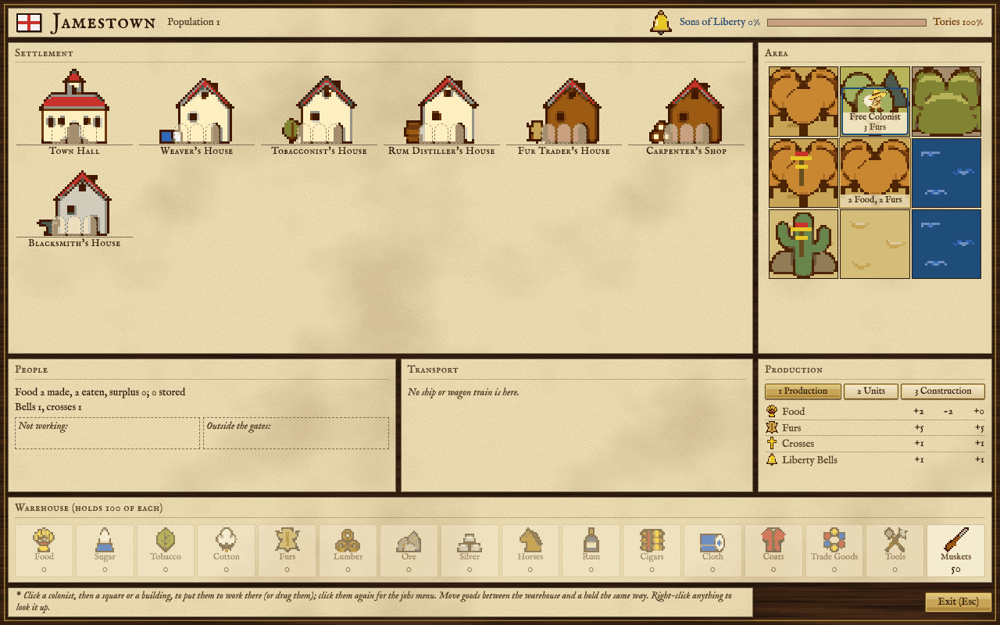

- **The header** shows the flag, the colony's name and its population. On the right, the bell and the bar show the colony's Sons of Liberty (blue) against its Tories (red), as percentages.
- **Settlement** (top left) shows every building the colony has, with the people working in each. Empty places beside a building show how many more can work there.
- **Area** (top right) is the colony's square in the middle and the eight around it, drawn as they look on the map. A colonist working a square stands on it with what he makes; an empty square that is worth working shows what a free colonist would make there.
- **People** (middle left) gives the food line (made, eaten, surplus or shortfall, and the store), the bells and crosses made each turn, colonists **Not working**, and the units standing **Outside the gates**: units on the colony's square that are not part of it, such as soldiers, scouts and new colonists.
- **Transport** (middle) lists the ships and wagon trains in the colony, with their holds. Click one to see what it carries.
- **The panel** (middle right) has three views: **1 Production** (what is made, used and the net, good by good), **2 Units** (the units outside the gates and the carriers) and **3 Construction** (the project, its hammers and tools, and the Change and Buy buttons). Press **M** to step from one to the next, or 1, 2 or 3 to pick one.
- **Warehouse** (bottom) holds one box for each of the sixteen goods, with the amount in store. Its title says how much of each the colony keeps. A good over that limit is marked. With a Custom House, a **Custom House (X)** button sits here too.
- **The help line** at the bottom says what a click will do next, and **Exit (Esc)** closes the screen.

A bigger colony, with experts at work, a stockade, docks and a printing press:

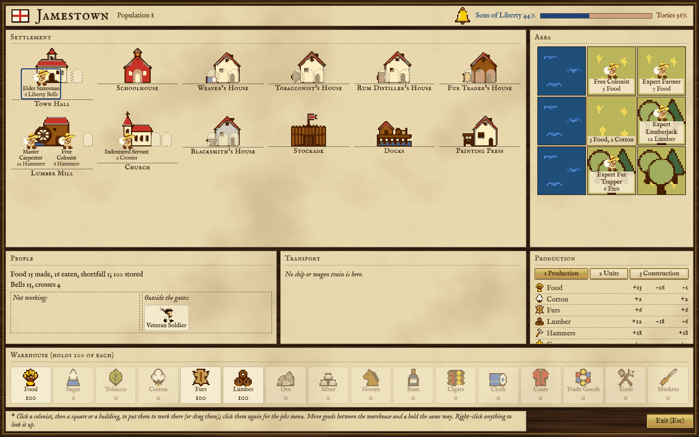

From the keyboard, **Tab** moves from one region to the next, the arrows move the highlight within a region, and **Enter** opens the menu for whoever is highlighted. **N** hides or shows the production numbers on the squares and buildings. **F1** shows a short reminder of the keys. The whole list is on [[Controls]].

## Putting people to work

Click a colonist, then click a square or a building, and he goes to work there. Or drag him: a faded copy follows the pointer and turns red where he cannot go. Click a colonist who is already selected to open his jobs menu, which lists every job he can take here with what he would make, and also lets him leave the colony.

A square may be refused: another colonist may work it already, a neighbouring colony may be using it, or a foreign unit may stand on it. Fish come only from water squares, and only once the colony has Docks. A building takes three workers at most.

Units outside the gates, and passengers aboard a ship in port, have their own menu: join the colony, take up or lay down equipment (muskets, horses, tools), sentry or fortify, and for a passenger, go ashore. Drag a unit into a square or building to have him join and work there, or drag a colonist to Outside the gates to have him leave the colony as a unit.

If you put a colonist on native land, you are asked whether to take it, pay for it or leave it ([[Native Peoples]]).

Goods move the same way. Click or drag a good from the warehouse onto a ship or wagon train to load a hold of it, and a hold onto the warehouse to unload it. Hold **Shift** to choose how many. **L** loads the most valuable cargo, **U** unloads.

Right-click anything on the screen to look it up in the encyclopedia.

### Who works best where

Every colonist makes a base amount: an expert or a free colonist 3 in a building, an indentured servant 2, a petty criminal and an Indian convert 1. An expert doing his own trade makes twice as much: a Master Weaver weaves twice the cloth, an Expert Farmer grows more food. Outdoors, what a square gives depends on its terrain, its river, its road, whether it is plowed and any resource on it; [[The Map]] has the numbers. Servants and criminals are fine in the fields but poor indoors, so put free colonists and experts in the buildings.

## Goods

Each good in the warehouse is either raw (it comes from the land) or made from another good in a building. Made goods sell for more. Hammers, crosses and liberty bells are made like goods but are never cargo: they cannot be stored, carried or sold.

The squares listed are the best for each raw good, with what a free colonist makes there before roads, rivers, plowing and resources.

<!-- table: goods -->

| Icon | Cargo | Raw or made | Made from | Made by | Made in |
| :--- | :--- | :--- | :--- | :--- | :--- |
|  | Food | Raw | Land; water too once the colony has Docks (fish) | Expert Farmer, Expert Fisherman | A square: Plains 5, Savannah 4, Tundra 3 and 14 more; at sea Ocean 3, Sea Lane 3 |
| 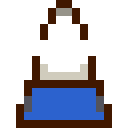 | Sugar | Raw | Land | Master Sugar Planter | A square: Savannah 3, Swamp 2, Tropical Forest 1 and 1 more |
|  | Tobacco | Raw | Land | Master Tobacco Planter | A square: Grassland 3, Marsh 2, Conifer Forest 1 and 1 more |
|  | Cotton | Raw | Land | Master Cotton Planter | A square: Prairie 3, Plains 2, Desert 1 and 3 more |
|  | Furs | Raw | Land | Expert Fur Trapper | A square: Boreal Forest 3, Mixed Forest 3, Scrub Forest 2 and 5 more |
| 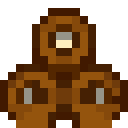 | Lumber | Raw | Land | Expert Lumberjack | A square: Mixed Forest 6, Conifer Forest 6, Boreal Forest 4 and 5 more |
| 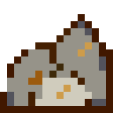 | Ore | Raw | Land | Expert Ore Miner | A square: Mountains 4, Hills 4, Tundra 2 and 8 more |
| 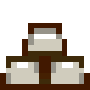 | Silver | Raw | Land | Expert Silver Miner | A square: Mountains 1 |
|  | Horses | Bred | Spare food | Nobody: they breed by themselves | A colony with 2 or more; faster with a Stable |
| 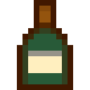 | Rum | Made | Sugar | Anyone as distiller; the expert is the Master Distiller | Rum Distiller's House → Rum Distillery → Rum Factory |
| 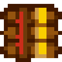 | Cigars | Made | Tobacco | Anyone as tobacconist; the expert is the Master Tobacconist | Tobacconist's House → Tobacconist's Shop → Cigar Factory |
|  | Cloth | Made | Cotton | Anyone as weaver; the expert is the Master Weaver | Weaver's House → Weaver's Shop → Textile Mill |
| 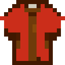 | Coats | Made | Furs | Anyone as fur trader; the expert is the Master Fur Trader | Fur Trader's House → Fur Trading Post → Fur Factory |
|  | Trade Goods | Bought | Not made in a colony | - | Europe |
| 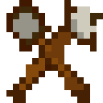 | Tools | Made | Ore | Anyone as blacksmith; the expert is the Master Blacksmith | Blacksmith's House → Blacksmith's Shop → Iron Works |
|  | Muskets | Made | Tools | Anyone as gunsmith; the expert is the Master Gunsmith | Armory → Magazine → Arsenal |
| 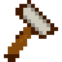 | Hammers | Made, not cargo | Lumber | Anyone as carpenter; the expert is the Master Carpenter | Carpenter's Shop → Lumber Mill |
|  | Crosses | Made, not cargo | Nothing | Anyone as preacher; the expert is the Firebrand Preacher | Church → Cathedral (the colony makes 1 a turn by itself) |
|  | Liberty Bells | Made, not cargo | Nothing | Anyone as statesman; the expert is the Elder Statesman | Town Hall (the colony rings 1 a turn by itself) |

<!-- /table -->

Within a turn the chain carries on: ore mined this turn can become tools, and those tools muskets, in the same turn. When a workshop runs short of its raw material it makes less, and the production view shows the shortfall.

## Food, growth and starvation

 Every colonist living in the colony eats 2 food a turn. Units outside the gates eat nothing. What is left over goes into store; food is never limited by the warehouse.

When the store reaches 200, 200 food is used and a new free colonist appears outside the gates.

When a turn's food and the store together are not enough, the store empties and you are warned. If the store was already empty at the start of the turn, a colonist starves to death; if he was the last, the colony is gone. The People line shows the shortfall, and you are warned when the store will run out within four turns. On the two easiest levels nobody starves before 1520, and after that only some of the deaths that are due happen.

## Horses

 Horses breed by themselves in a colony with at least two of them and food to spare. The herd can grow by 2 for every 50 horses or part of 50 (every 25 with a Stable), but no more than half the turn's food surplus, and no more than the warehouse has room for. Each new horse uses one food from that turn's surplus; stored food is never touched. Fifty horses mount a scout or a dragoon.

## The warehouse and spoilage

A colony keeps 100 of each good; a Warehouse raises that to 200 and a Warehouse Expansion to 300. Food is the only good not limited. At the very end of the colony's turn, everything over the limit is thrown away. You are told when goods already in store were lost; the part that was this turn's own extra goes without a word. During the turn the stock may run over, and unloading a ship over the limit only warns you, so you have until the turn ends to ship the extra away.

You are also told when a good passes another hundred, and when it fills the warehouse.

## Sons of Liberty

 Liberty bells stand for your colonists' wish for independence. Statesmen ring them in the Town Hall, and every colony rings one a turn by itself. A Printing Press adds half again, a Newspaper doubles them instead, and three Founding Fathers help: Thomas Jefferson (half again), Thomas Paine (the tax rate as a percentage) and Simon Bolivar (20 points of membership in every colony). See [[Founding Fathers]]. The same bells bring Founding Fathers into the Congress and raise the rebel sentiment you need to declare independence ([[The Crown and Independence]]).

**Membership** is the share of the colony's people who are Sons of Liberty; the rest are Tories. Bells raise it slowly, a little each turn, and it slips back unless bells keep coming. Left to settle, a colony ringing one bell a turn for each colonist ends near 50%, and two bells for each colonist near 100%. New colonists dilute it; people leaving or dying raise it. In a colony making fewer bells than it has people, some of the bells are lost.

**The production bonus.** At 50% membership every worker in the colony, in the fields and in the buildings, makes one more of whatever he makes. At 100% he makes two more. The bonus changes by one step a turn at most, and once at 100% the colony keeps the second step until membership falls below 95%. The centre square gets the bonus too. Each change is announced.

**The Tory penalty.** Tories in a big colony make everyone less productive. Count the Tories (the population times the Tory share, rounded); for every 10 of them on Discoverer, 9 on Explorer, 8 on Conquistador, 7 on Governor or 6 on Viceroy, every worker makes one less, and the penalty is taken from the bonus. A colony of five or fewer never has enough Tories to suffer, but a colony of twenty with no Sons of Liberty loses two or more from every worker. You are warned when a colony reaches the penalty.

Your nation's **rebel sentiment** is the membership of all your colonies together, weighted by their population.

## Crosses

 Every colony makes one cross a turn, two with a Church and three with a Cathedral. Preachers working in the church make more. Crosses from all your colonies add up, and when there are enough another immigrant is ready to come to the docks in Europe ([[Europe and Trade]]).

## Schooling

A school turns unskilled colonists into experts. Put an expert in a Schoolhouse, College or University as a teacher, and every few turns one colonist of the colony moves up a rung: a petty criminal becomes an indentured servant, a servant becomes a free colonist, and a free colonist becomes an expert in the teacher's trade. The pupil is picked at random from the colony's criminals, servants and free colonists, wherever they work. Indian converts are never taught.

A teacher needs 4 turns per pupil if his trade is taught at the first level, 6 at the second and 8 at the third. Trades of the first level can be taught in a Schoolhouse, the second need a College, the third a University. A Schoolhouse seats one teacher, a College two, a University three. A colony can have at most three graduates in a turn. If there is nobody left to teach, you are told and that turn's lessons are lost. Which trade is taught at which level is in the professions table on [[Units]].

Colonists can also learn on the job. A free colonist, servant or criminal working as a sugar, tobacco or cotton planter or as a fur trapper may become the expert of that work, by chance, with one chance in 100, 200 or 300 a turn. This happens only while you have no such expert anywhere.

## The Custom House

The Custom House sells goods for you without a ship. It needs Peter Stuyvesant in the Congress (see [[Buildings]]). In a colony with one, press **X** or the **Custom House (X)** button in the warehouse to open the export list, and tick the goods to sell. A good on the list shows "export" in the warehouse.

Each turn, any listed good with 100 or more in store is sold down to 50, at the price Europe pays and taxed as a sale there. After the Declaration no tax is taken. A boycott does not stop it. The sale happens after the builders take their tools, and before the warehouse is trimmed, so the Custom House is a good way to keep a busy warehouse from overflowing. While a warship of another power is within five squares of the colony, nothing is sold.

## Trade routes

A trade route sends a ship or wagon train round your colonies on its own, turn after turn, unloading and loading what you have listed at each stop.

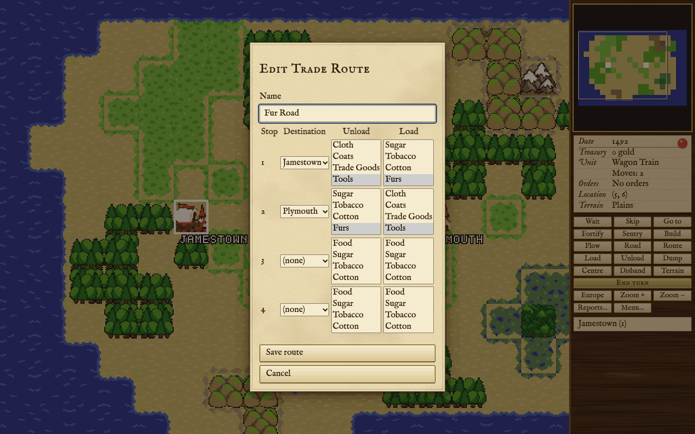

Press **Alt+T** for the trade menu, where you create, edit or delete a route. A route is by land (wagon trains) or by sea (ships). It has up to four stops, each one of your colonies, and at each stop up to six goods to unload and six to load. The carrier unloads everything of the listed goods it carries, then loads as much of each listed good as the colony has and the holds can take. You may keep twelve routes. To put a ship or wagon train on a route, select it and press **T**. Routes call only at colonies; a ship on a route does not sail to Europe.

## When a colonist arrives

A colonist who joins without being told where to work is given a job. If the colony feeds itself, has three or more people, is building something and has no carpenter, he becomes a carpenter. Otherwise the game looks at every free square for every outdoor job and picks the one that makes the most, counting what the goods are worth in Europe, with an expert's own work counting double. While the colony is short of food, food comes first. If no square is worth working he becomes a carpenter. You can always move him afterwards.

## Leaving and losing a colony

A colonist can leave the colony through his jobs menu or by being dragged outside the gates, but the last colonist cannot. A colony with a Stockade or stronger works cannot drop below three colonists by choice. The colony screen offers no way to abandon a colony; a colony ends only when it starves out or is taken.

When a colony is lost, its owner's ships in its port leave damaged and lose their cargo, sailing for the nearest colony with a Drydock, or for Europe.

## When a colony is attacked

A colony is defended by its best soldier. If there is none, a colonist picks up a musket and fights poorly; if he loses, the colony falls to a European attacker, with its people, buildings and stores. A Stockade, Fort or Fortress makes the defenders much stronger, and artillery helps inside the walls. Natives raid rather than conquer: they burn buildings, steal goods and gold, or damage ships. While enemy soldiers outnumber yours around a colony it is under siege, and colonists can leave it only as soldiers. All of this is on [[Combat]].
