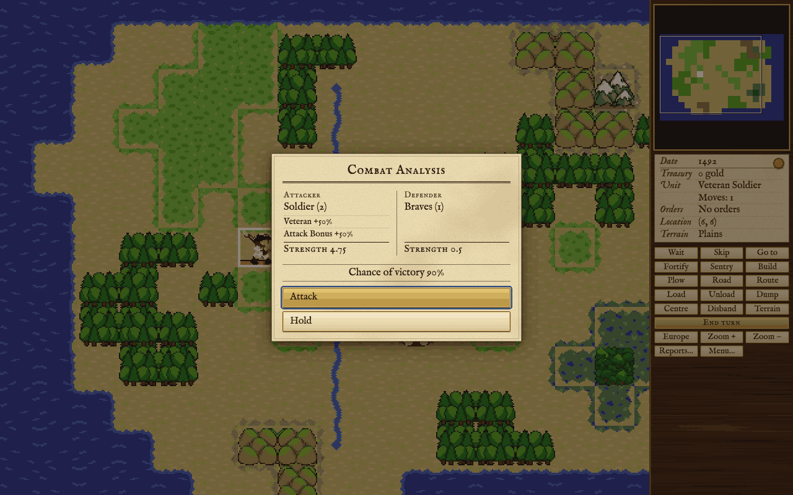

How fights are decided on land and at sea, and how colonies are attacked and defended.

A fight is always one unit against one: the unit you send in, against the defender the other side puts up. This page explains how each side's strength is worked out, what happens to the loser, and the special cases of colonies, ships and the native peoples. The units themselves are on [[Units]].

## How a fight is decided

You attack by moving a unit with an attack value onto a square held by someone else. The attacker's strength starts from its attack value and the defender's from its defence value, as listed on [[Units]]. Each is then raised or lowered by the modifiers below: veterans fight better, the ground and the walls of a colony help the defender, and every attacker has an edge of half again.

Then one throw decides it. The attacker's chance of winning is its strength over both strengths added together: an attack of 6 against a defence of 2 wins three times in four. There is no draw. On land the winner stays on its own square unless it has taken a colony (below), and the attack uses a full move; a mounted unit keeps any moves it has left after that. With less than a full move left a unit can still attack, but more weakly (Fatigue, below).

Some adjustments are not shown in the Combat Analysis dialog. A human side gets a small edge that grows on the easier levels, and on the two easiest levels a human's colonies are shielded early in the game. A real fighting unit attacking a unit that is hardly armed (a defence under 2) halves its defence. Natives never take a power's last colony.

**What happens to the loser** depends on what it is:

- A dragoon loses its horses and becomes a soldier; a soldier loses its muskets and becomes a colonist, or a missionary again if he is a Jesuit Missionary. Continental Cavalry becomes Continental Army, and Continental Army a colonist; the King's Cavalry becomes regulars.
- Artillery is damaged; damaged artillery is destroyed.
- Scouts, pioneers, missionaries, the King's regulars and every native band are destroyed.
- Colonists, wagon trains and treasure trains are captured by a European unit with an attack value, and destroyed by natives.
- A ship is crippled or sunk (see [[Combat#Naval combat]]).

A winning soldier or dragoon may be promoted; see [[Units]]. Attacking another power's unit puts the two of you at war, except with a privateer.

## The Combat Analysis dialog

Before an attack the game shows both sides: each unit's base strength, a line for each modifier with its percentage, the strength that results, and your chance of victory. Enter or Attack goes ahead; Escape or Hold calls it off. A ship that may outrun you is marked "if they do not outrun us". The dialog can be switched off in the game options (Alt+G).

These are all the modifiers the dialog can show. A defender's bonus for its place (the ground, a colony's walls or a settlement) and its bonus for being fortified are added together; the others are applied one after another.

<!-- table: combat-modifiers -->

| Modifier | Side | When it applies | How much |
| :--- | :--- | :--- | :--- |
| Attack Bonus | Attacker | Every attack, on land and at sea | +50% |
| Veteran | Either | A soldier or dragoon who is a Veteran Soldier | +50% |
| Ambush | Attacker | Natives attacking a European unit in the open that is not Fortified; after the Declaration, rebels attacking from outside a colony | +25% for each point of the square's defence (+25% to +150%) |
| Fatigue | Attacker | Less than a full move left: two thirds, or one third | -33% or -66% |
| Artillery In Open | Either | Artillery fighting outside a colony or settlement, unless the defender is a European unit fortifying or fortified | -75% |
| Spain Bonus | Attacker | Spain attacking a native settlement | +50% |
| Bombard | Attacker | After the Declaration: the Crown's troops attacking a colony, and the rebels once a foreign power has intervened | +50% |
| Tory Unrest | Attacker | After the Declaration: the Crown's troops attacking a colony | + the colony's Tory percentage |
| Rebel Unrest | Attacker | After the Declaration: the rebels attacking a colony | + the colony's Sons of Liberty percentage |
| Terrain | Defender | A unit in the open, unless it is ambushed | +25% for each point of the square's defence (+25% to +150%) |
| Settlement | Defender | A native settlement; a capital counts double | +50% for camps and villages, +100% for cities; a capital +100% or +200% |
| Colony | Defender | A colony with no stockade | +50% |
| Stockade | Defender | A colony with a stockade | +100% |
| Fort | Defender | A colony with a fort | +150% |
| Fortress | Defender | A colony with a fortress | +200% |
| Fortified | Defender | A land unit that has finished fortifying, where the place gives +100% or less | +50% |
| Artillery Vs. Raid | Defender | Artillery in a colony attacked by natives | +100% |
| Drake | Either | A privateer whose owner has Francis Drake in the Congress | +50% |

<!-- /table -->

## Attacking and defending colonies

**Who defends.** A colony is defended by its best armed unit: the one with the highest defence there once every bonus is counted. Only units with an attack value count, so a colony full of colonists and pioneers has no defender. Then a colonist is drafted and fights with a defence of 1; with Paul Revere in the Congress and fifty muskets in store he takes them up and fights at 2.

**Walls.** A colony's walls help every defender inside it: a bare colony gives half again, a Stockade twice the strength, a Fort two and a half times and a Fortress three times (see the table). Fortifying adds nothing more behind a fort or a fortress. Artillery is strong behind walls and doubles its defence against a native raid, but outside a colony it fights at a quarter, attacking or defending, unless the European unit defending is fortifying or fortified.

**Capture.** When a European attacker beats a drafted colonist, it takes the colony. The colony changes hands with all its colonists, buildings and stores; the victor moves in, the land the colony worked goes to the captor, and the two powers are at war. Before a Declaration of Independence the captor also takes gold: the loser's treasury times this colony's share of the loser's colonists. The colony keeps two thirds of its Sons of Liberty. The loser's other land units there are taken too, and its ships in port are crippled and sent away. If an armed defender loses, it is beaten as usual and the colony stands.

**Siege.** A colony is under siege while enemy fighting units on it and around it outnumber its owner's (scouts and ships are not counted). Then a colonist may leave the colony only as a soldier, taking fifty muskets from the stores.

**Scouts at the gate.** A scout beside a foreign colony may try to slip in and look it over. Each level of walls makes him likelier to be caught, and a Seasoned Scout is caught half as often. A caught scout is lost and his horses go to the colony.

During the War of Independence you may attack only the Crown's colonies.

## Naval combat

Only the Privateer, the Frigate and the Man-O-War can attack, and only at sea: a ship in a colony is not attacked this way. A ship fights at its own attack or defence, with the attacker's edge of half again and fatigue as on land; a privateer whose owner has Francis Drake fights half again as well. Every hold in use, for cargo or passengers, makes a ship a little weaker. There is no ground and no fortifying at sea.

**Evading.** If the ship attacked has a lower attack value than the attacker, it may simply get away. Fast ships escape more often, a privateer most of all and a galleon a little; each full hold makes escape harder.

**The loser** is sunk or crippled. The more guns the victor has against the loser's hull, the likelier it sinks. A power with many cargo ships loses them outright more often, but a power about to run short of holds for its colonists has its ships crippled instead. A caravel late in the game is not worth saving and is sunk. A crippled ship goes for repairs (see [[Units]]).

**Cargo.** Whatever the loser carried, the victor takes a hold at a time, the most valuable first, while it has room. The rest is lost, and so is everyone aboard. A victorious attacker moves onto the loser's square if nothing else is there.

**Flags.** Privateers fly no flag: a privateer may attack the ships of a power you are at peace with, and it does not start a war. The victim notes the piracy and may come to bear a grudge (see [[Other Powers]]). Attacking with a frigate or a man-of-war is an act of war.

**Zones of patrol.** After each step a ship takes at sea, every warship next to it that belongs to a power it is not at peace with may hold it up, costing it part of its move: more for a man-of-war than a frigate, more for a frigate than a privateer. Peace does not cover privateers: a privateer may hold up any other power's ship, and any power's warship may hold up a privateer. A nimble ship often slips past.

**Fort fire.** A ship that ends a step beside an enemy colony with a fort loses part of its move, and beside a fortress it loses all of it. In its own turn a colony with a fort or a fortress fires on an enemy ship beside it, harder for a fortress and for each piece of artillery inside. A stockade does not fire. To a privateer every other power's colony is an enemy's: its fort slows the privateer and fires on it even in peacetime.

## Fighting the natives

Attacking a native band or settlement angers its whole tribe, whoever wins, and a settlement or capital far more than a band in the open. A settlement defends with a band of braves, armed if the tribe has muskets and mounted if it has horses. Each victory over a settlement costs it one of its people; when it is down to its last it is destroyed and its land is free. The ruins may hold a treasure train, and always do at a capital; the city peoples' treasure is the largest. A tribe that loses its capital is cowed.

Braves fight back in three ways:

- **In the open** they ambush: the ground helps the brave rather than your unit, unless your unit is fortified. A brave who beats a dragoon or scout takes its horses, and one who beats a soldier takes his muskets, if his people lack them.
- **At a colony's gate** a brave may beg for food, bring a gift, or demand goods. Refuse a demand and the tribe grows angrier. A tribe that is angry enough attacks instead.
- **In a raid.** A brave who beats a colony's defender raids it and goes home: it may carry off goods or gold, wreck a building or damage a ship. Walls make a raid likelier to come to nothing. The beaten defender fares as in any lost fight: a soldier loses his muskets, a dragoon his horses, artillery is damaged and damaged artillery is destroyed. With nobody under arms a colonist takes up the defence; if he loses, nobody is hurt but the colony is raided all the same, and a colony of one colonist is burned to the ground.

A tribe pushed to the limit may also burn your missions among its people. All of this, and how to keep the peace, is on [[Native Peoples]].

## The War of Independence

When you declare independence the Crown sends its Expeditionary Force: King's Regulars, King's Cavalry, artillery and Men-O-War. In this war the Crown's troops bombard your colonies and gain from every Tory in them, while your troops gain from the Sons of Liberty in a colony they retake, and from the ground when they fall on the Crown's troops from outside a colony. Your veterans who win join the Continental Army. See [[The Crown and Independence]].
