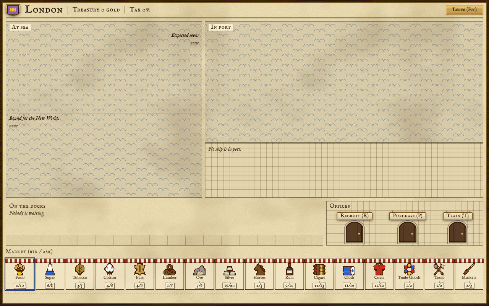
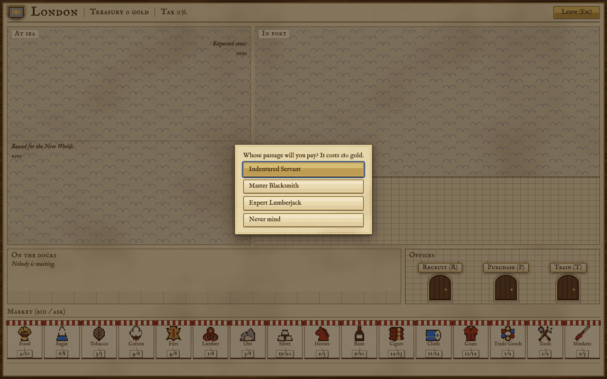
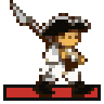
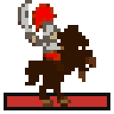
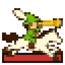
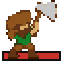

Europe is where your colonies sell what they make and buy what they cannot make yet. It is also where new colonists come from: some cross on their own, drawn by your churches, and you can pay the passage of others, train experts or buy ships and guns. This page covers the trip there and back, the Europe screen, the market, recruiting, training, purchases, the Custom House and the Crown's taxes.

## Getting there and back

Europe is not on the map. A ship reaches it by sailing onto the **Sea Lane**, the band of open water along the east and west edges of the map, and then out to sea.

- **Sailing by hand.** When a ship steps east, north-east or south-east from one Sea Lane square onto another, or steps off the east or west edge of the map, the game asks: "The open ocean lies ahead. Shall we set course for Europe?" Say yes and she leaves the map with everyone and everything aboard.
- **Go To Europe.** Press **G** with a ship selected. If the water she is in reaches the Sea Lane, Europe is the first entry in the list, ahead of your colonies. She makes for the nearest Sea Lane square, over as many turns as it takes, and sets sail without asking.
- **The crossing.** A ship arrives at the start of your second turn after she left. Now and then, if you own three ships or more, a crossing takes a turn longer; Ferdinand Magellan ends that. The voyage home follows the same rule, rolled afresh.
- **Turning back.** A ship at sea can be turned around from the Europe screen (the **Turn back** button under her). She needs two turns to get back to where she came from.
- **Coming home.** A returning ship reappears on the square she left from, or on the nearest free Sea Lane square to it.

### The Europe button

The **Europe** button (or **E**) opens the Europe screen at any time, even with no ship there: you can recruit, train and buy while your ships are away. The button has two looks besides its plain one:

- **A brass plate**: a ship of yours lies in port in Europe, waiting for orders.
- **A small red wax mark** in its corner: ships of yours are crossing. Rest the pointer on the button and its note says which ship arrives or returns in how many turns.

## The Europe screen

The header gives the name of your home port, your treasury and the tax rate. Below it:

- **At sea** lists your ships on the way: those *expected soon* in port, and those *bound for the New World*, each with the turns to go and a **Turn back** button.
- **In port** shows each ship alongside the quay, with her cargo set down beside her as crates and her passengers by them. Click a ship to make her the one you are loading. Click a crate to sell it. **Set sail** sends her back to the New World; **Sell all cargo** sells every hold.
- **On the docks** are the people waiting for a ship: newcomers, recruits, graduates and anyone you landed. Click one to have them board the ship in port now, board the next ship that sails, or stay; or to fit them out as a soldier, dragoon, scout, pioneer or missionary. Someone marked *(staying)* will not board on their own.
- **Offices** are three counters: **Recruit (R)**, **Purchase (P)** and **Train (T)**. Each is described below.
- **Market (bid / ask)** is a row of stalls, one per good, with two prices on its tag.
- Along the bottom, **the harbour-master notes** what your last deal cost or earned.

**Leave (Esc)** or **E** closes the screen. The arrow keys move the highlight; the keys for the screen are in [[Controls]].

## Buying and selling

Every good has two prices. The **bid** is what Europe pays you for one unit; the **ask** is what it charges you. The ask is always higher. The tag on each stall reads bid / ask.

- **To buy**, select the ship in port and click a stall (or press **L**): that buys a full hold of 100 into her. **+** asks how many instead. You need the gold and a free hold, or room in a hold of the same good.
- **To sell**, click a crate on the quay (or press **U**): that sells the lot, up to 100 at a time. **_** asks how many.
- **Tax** is taken from what you sell, never from what you buy. The harbour-master's note shows the gross, the tax and what you keep.

### Why prices move

Trade moves prices, a step at a time. Selling a good pushes its price down; buying it pushes it up. A single sale may not move a price at once, but the market remembers how much has changed hands, and when enough has, the price steps. Left alone, most prices drift back up as Europe's appetite returns, so a good you flooded recovers over the following turns. Trade goods, tools and muskets go the other way: Europe makes them, and their prices sink slowly unless someone keeps buying.

- **You are not alone.** The other powers sell into the same market, so their trade pushes your prices too. A glut of furs from a rival lowers what you are paid for yours.
- **Manufactured goods** (rum, cigars, cloth and coats) are priced against one another. Selling a great deal of one makes it cheaper while the others hold their value or gain a little, so a colony that makes two of them sells more for the same fall.
- **Raw goods** (sugar, tobacco, cotton and furs) feel a weaker pull of the same kind. Furs are in fashion early in the game and fetch a little more before 1700.
- **The level you play** changes how hard your own trade hits the market: on the harder levels each sale and purchase counts for more.
- The Dutch market is steadier than the others: it feels only part of everyone's sales.

The table gives each good's opening bid, the lowest and highest it can go, and how far the ask stands above the bid. The four manufactured goods open where the market's demand for them puts them, which differs from game to game.

<!-- table: market -->

|  | Good | Opening bid | Lowest bid | Highest bid | Ask is the bid plus |
| :--- | :--- | :--- | :--- | :--- | :--- |
|  | Food | 0 to 2 | 0 | 5 | 8 |
|  | Sugar | 3 to 6 | 2 | 6 | 2 |
|  | Tobacco | 2 to 4 | 1 | 4 | 2 |
|  | Cotton | 1 to 4 | 1 | 4 | 2 |
|  | Furs | 3 to 5 | 1 | 5 | 2 |
|  | Lumber | 1 | 1 | 1 | 5 |
|  | Ore | 2 to 5 | 1 | 5 | 3 |
|  | Silver | 19 | 1 | 19 | 1 |
|  | Horses | 1 to 2 | 1 | 10 | 1 |
|  | Rum | set by demand | 0 | 19 | 1 |
|  | Cigars | set by demand | 0 | 19 | 1 |
|  | Cloth | set by demand | 0 | 19 | 1 |
|  | Coats | set by demand | 0 | 19 | 1 |
|  | Trade Goods | 1 to 2 | 1 | 11 | 1 |
|  | Tools | 1 | 1 | 8 | 1 |
|  | Muskets | 2 | 1 | 19 | 1 |

<!-- /table -->

### Boycotts

A good under **boycott** shows *boycott* on its stall. You can neither buy it nor sell it in Europe, and nobody on the docks can be fitted out with it. A boycott comes from refusing a tax rise (see [[Taxes|Europe and Trade#Taxes]] below). It lasts until the back taxes are paid: 500 times the good's asking price. Jakob Fugger lifts every boycott at once when he joins the Congress (see [[Founding Fathers]]). The Europe screen has no counter for paying back taxes yet, so for now Fugger is the way to lift one.

A Custom House goes on selling a boycotted good (see [[The Custom House|Europe and Trade#The Custom House]]).

## Recruiting

Three would-be colonists wait in Europe for a passage. **Recruit (R)** shows them and the price: pay it and the one you pick steps onto the docks, ready to board the next ship. Another takes their place in the line.

**Crosses** decide both who comes and what passage costs. Your colonies make crosses: one a turn each, more with a church and its preachers (see [[Colonies]] and [[Buildings]]). The Religious Adviser (**F2**) shows how many you have, how many you need and how long that will take.

- **When you have enough crosses**, someone comes over free. One of the three is chosen at random, the crosses start again from nothing, and a newcomer joins the line. With William Brewster you choose which of the three comes.
- **How many you need** grows with your people: 8, plus 2 for every colonist in your colonies and every unit you own. England needs only two thirds of that.
- **The docks matter.** While nobody waits there you gain 2 crosses a turn extra; every person left waiting costs you 2 a turn. Ship people out promptly.
- **The price of passage** falls as your crosses build toward the next newcomer, and its full price rises by 20 gold for every passage you have paid. Paying for someone also spends the crosses you had gathered, so the next free crossing is further off.

### Who comes

When a place in the line is filled, the game first tries the unskilled kinds and only then draws a skilled colonist. Petty criminals and indentured servants are more common on the harder levels. With William Brewster, criminals and servants no longer join the line, and those already in it are replaced by free colonists. When crosses bring someone over by lot on a turn divisible by four, the newcomer who fills the gap is always skilled.

<!-- table: immigrant-odds -->

| Level | Petty Criminal | Indentured Servant | Free Colonist | Skilled |
| :--- | :--- | :--- | :--- | :--- |
| Discoverer | 7% | 9% | 11% | 74% |
| Explorer | 13% | 17% | 17% | 52% |
| Conquistador | 13% | 17% | 17% | 52% |
| Governor | 20% | 24% | 21% | 35% |
| Viceroy | 20% | 24% | 21% | 35% |

<!-- /table -->

A skilled draw never repeats a calling already in the line, and if all three in line are already skilled, it gives a free colonist instead. Sugar, tobacco and cotton planters, fur trappers and teachers never come this way. Some newcomers arrive ready for their trade, and a veteran soldier now and then arrives mounted, as a dragoon.

<!-- table: skilled-immigrants -->

| Calling | Chance (out of 25) | Steps ashore as |
| :--- | :--- | :--- |
| Master Carpenter | 3 | a colonist |
| Expert Farmer | 2 | a colonist |
| Expert Fisherman | 2 | a colonist |
| Expert Lumberjack | 2 | a colonist |
| Expert Ore Miner | 2 | a colonist |
| Seasoned Scout | 2 | a scout with 50 horses |
| Expert Silver Miner | 1 | a colonist |
| Master Distiller | 1 | a colonist |
| Master Tobacconist | 1 | a colonist |
| Master Weaver | 1 | a colonist |
| Master Fur Trader | 1 | a colonist |
| Master Blacksmith | 1 | a colonist |
| Master Gunsmith | 1 | a colonist |
| Firebrand Preacher | 1 | a colonist |
| Elder Statesman | 1 | a colonist |
| Hardy Pioneer | 1 | a pioneer with 100 tools |
| Veteran Soldier | 1 | a soldier with 50 muskets |
| Jesuit Missionary | 1 | a missionary |

<!-- /table -->

Your first line is set by the level. On the easiest it is a master carpenter, an expert farmer and a seasoned scout; on the second, an indentured servant, an expert farmer and a seasoned scout; above that, an indentured servant (a petty criminal on the hardest level) and two draws. Spain's first place always goes to a Jesuit missionary. The kinds of colonist and what each is good at are in [[Units]].

## Training at the Royal University

**Train (T)** lists the experts the Royal University turns out, cheapest first. Pay and the graduate waits on the docks. Pioneers, soldiers and missionaries leave fitted out for their work. Prices never change.

<!-- table: training -->

| Profession | Price in gold | Leaves as |
| :--- | :--- | :--- |
| Expert Ore Miner | 600 | a colonist |
| Expert Lumberjack | 700 | a colonist |
| Master Gunsmith | 850 | a colonist |
| Expert Silver Miner | 900 | a colonist |
| Master Fur Trader | 950 | a colonist |
| Expert Fisherman | 1000 | a colonist |
| Master Carpenter | 1000 | a colonist |
| Master Blacksmith | 1050 | a colonist |
| Expert Farmer | 1100 | a colonist |
| Master Distiller | 1100 | a colonist |
| Master Tobacconist | 1200 | a colonist |
| Hardy Pioneer | 1200 | a pioneer with 100 tools |
| Master Weaver | 1300 | a colonist |
| Jesuit Missionary | 1400 | a missionary |
| Firebrand Preacher | 1500 | a colonist |
| Elder Statesman | 1900 | a colonist |
| Veteran Soldier | 2000 | a soldier with 50 muskets |

<!-- /table -->

Planters, fur trappers, scouts and teachers are not taught here; scouts, planters and trappers can learn from the natives (see [[Native Peoples]]).

## Purchases

**Purchase (P)** sells ships and artillery. A ship you buy lies in port, ready to load; a gun waits on the docks for a ship. Each piece of artillery costs more than the last. Ships keep their price.

Muskets, horses and tools are bought in the market like any other good. You can also fit out someone on the docks directly: click them and choose the kit. That is charged at the asking price, and handing kit back pays the bid with no tax taken. Blessing a missionary costs nothing.

<!-- table: purchases -->

|  | What | Price in gold | Notes |
| :--- | :--- | :--- | :--- |
|  | Artillery | 500, and 100 more for each one bought before | a field gun, ready on the docks |
|  | Caravel | 1000 | a ship of 2 holds |
|  | Merchantman | 2000 | a ship of 4 holds |
|  | Galleon | 3000 | a ship of 6 holds |
|  | Privateer | 2000 | a ship of 2 holds |
|  | Frigate | 5000 | a ship of 4 holds |
|  | Soldier's kit | 50 muskets at the asking price | fitted to someone on the docks |
|  | Dragoon's kit | 50 muskets and 50 horses at the asking price | fitted to someone on the docks |
|  | Scout's kit | 50 horses at the asking price | fitted to someone on the docks |
|  | Pioneer's kit | 100 tools at the asking price | fitted to someone on the docks |

<!-- /table -->

## The Custom House

A **Custom House** sells your goods to Europe without a ship. You can build one only after Peter Stuyvesant joins the Congress (see [[Buildings]] and [[Founding Fathers]]).

- On the colony screen, the **Custom House (X)** button in the warehouse lists the goods; pick the ones to export. A flagged good shows *export* on its tag.
- During the colony's turn, after production, every flagged good with at least 100 in store is sold down to 50.
- The sale pays your bid less the usual tax. Boycotts do not stop it.
- A foreign warship within 5 squares of the colony stops the sales while it stays.
- After independence is declared, the Custom House is your only trade with Europe. It keeps selling, and no tax is taken.

## Taxes

The Crown takes a share of every sale in Europe and of every Custom House sale. The rate starts at 0% and can never pass 75%.

**How a raise comes.** Once you hold a colony and the game is past its thirtieth turn, the Crown reviews your taxes every so often: every 18 turns at first, then more often as the years pass (15 after 1600, 12 after 1700, 9 after 1750), more often on the harder levels and less often on the easier ones. Each review is a roll. Early on, most reviews end in a small rise and about one in ten brings a cut. The roll grows harsher with a large treasury, a high rebel sentiment, a late date and every Founding Father in your Congress (up to five); a rate that is already high softens it a little. A crowded Congress therefore tends to bring the steeper rises.

<!-- table: tax-events -->

| Event | Change to the tax rate |
| :--- | :--- |
| A victory abroad | -5 to -2 points |
| A royal wedding | +1 point |
| A war with a foreign enemy | +2 points |
| A Navigation Act | +3 to +4 points |
| A Stamp Act | +5 to +8 points |

<!-- /table -->

**The party.** When the Crown raises the tax, you choose: *Pay the new tax*, or *Hold a party* in one of your port colonies, where the people throw a cargo into the harbour. The game picks the good, usually one you trade a lot, and the colony that holds the most of it. A party:

- cancels the rise,
- destroys up to 100 of that good in that colony,
- raises Sons of Liberty membership there, and
- puts the good under boycott in Europe until you pay the back taxes.

A rise you leave unanswered is taken as paid at the end of the turn. Paying the frigate the Crown offers also comes as a tax rise, with the same choice (see [[The Crown and Independence]]).

**Back taxes** for a boycotted good are 500 times its asking price. Jakob Fugger forgives them all.

Once independence is declared you pay the Crown nothing, but Europe is closed to you; see [[The Crown and Independence]].
