The Continental Congress and the twenty-five Founding Fathers who can join it.

Each Founding Father who joins your Congress changes a rule of the game in your favour for the rest of it. They are bought with liberty bells, one at a time, so the order you choose them in is one of the larger decisions of a game.

## How the Congress works

**Bells.** Every liberty bell your colonies ring in a turn counts toward the next Founding Father. Bells come from statesmen in the Town Hall, helped by a printing press, a newspaper and some of the fathers themselves (see [[Colonies]] and [[Buildings]]). The same bells also raise Sons of Liberty membership in the colony that rings them, so they work twice.

**The choice.** The first time bells are rung, and again each time a father joins, the Congress asks you whom to seek next. It offers one name from each of the five fields (trade, exploration, military, political, religious), drawn at random among the fathers not yet seated and allowed in the present era. A field with nobody left to offer is skipped. You pick one; he becomes the candidate, and every bell goes toward him. If you leave the choice unmade at the end of the turn, it falls on the first name offered.

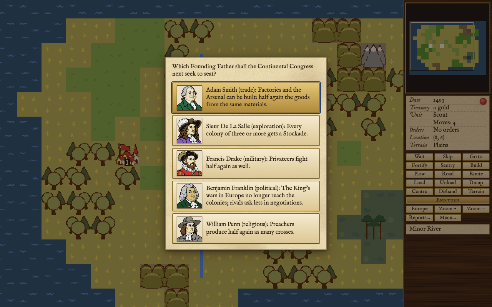

**The price.** When the bells reach the candidate's price he joins, the count goes back to nothing (bells beyond the price are lost) and the next choice is put to you. The price rises with each father already seated, and the whole scale rises by half in 1600, 1650, 1700 and 1750. The first father costs half. The number of colonies you hold makes no difference. The table gives the bells a father costs you, by level, by how many have joined before him, and by the year:

<!-- table: father-cost -->

| Level | From | 1st father | 2nd father | 3rd father | 5th father | 10th father |
| :--- | :--- | :--- | :--- | :--- | :--- | :--- |
| Discoverer | 1492 | 24 | 97 | 145 | 241 | 481 |
| Discoverer | 1600 | 36 | 145 | 217 | 361 | 721 |
| Discoverer | 1650 | 54 | 217 | 325 | 541 | 1081 |
| Discoverer | 1700 | 81 | 325 | 487 | 811 | 1621 |
| Discoverer | 1750 | 122 | 487 | 730 | 1216 | 2431 |
| Explorer | 1492 | 32 | 129 | 193 | 321 | 641 |
| Explorer | 1600 | 48 | 193 | 289 | 481 | 961 |
| Explorer | 1650 | 72 | 289 | 433 | 721 | 1441 |
| Explorer | 1700 | 108 | 433 | 649 | 1081 | 2161 |
| Explorer | 1750 | 162 | 649 | 973 | 1621 | 3241 |
| Conquistador | 1492 | 40 | 161 | 241 | 401 | 801 |
| Conquistador | 1600 | 60 | 241 | 361 | 601 | 1201 |
| Conquistador | 1650 | 90 | 361 | 541 | 901 | 1801 |
| Conquistador | 1700 | 135 | 541 | 811 | 1351 | 2701 |
| Conquistador | 1750 | 203 | 811 | 1216 | 2026 | 4051 |
| Governor | 1492 | 48 | 193 | 289 | 481 | 961 |
| Governor | 1600 | 72 | 289 | 433 | 721 | 1441 |
| Governor | 1650 | 108 | 433 | 649 | 1081 | 2161 |
| Governor | 1700 | 162 | 649 | 973 | 1621 | 3241 |
| Governor | 1750 | 243 | 973 | 1459 | 2431 | 4861 |
| Viceroy | 1492 | 56 | 225 | 337 | 561 | 1121 |
| Viceroy | 1600 | 84 | 337 | 505 | 841 | 1681 |
| Viceroy | 1650 | 126 | 505 | 757 | 1261 | 2521 |
| Viceroy | 1700 | 189 | 757 | 1135 | 1891 | 3781 |
| Viceroy | 1750 | 284 | 1135 | 1702 | 2836 | 5671 |

<!-- /table -->

**What lasts.** A father is never lost, and fathers are not exclusive: a rival power may seat the same man in its own Congress. A power can have all twenty-five. No father is sought after you declare independence; from then on your bells count toward help from abroad instead (see [[The Crown and Independence]]).

**The report.** Press F3 for the Continental Congress report: who sits in the Congress, the candidate and how many bells he still needs, the colonies' rebel sentiment, and the force the Crown holds ready.

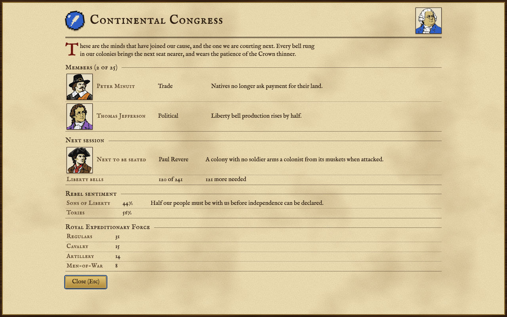

## The twenty-five

Every Founding Father, grouped by field, with what he does and the eras in which the Congress may offer him. A father missing from an era cannot be drawn in it; one who may be offered in all three is more likely in some than others.

<!-- table: fathers -->

|  | Founding Father | Field | Effect | May be offered |
| :--- | :--- | :--- | :--- | :--- |
| 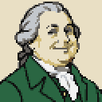 | Adam Smith | Trade | Factories and the Arsenal can be built: half again the goods from the same materials. | 1492 to 1600, 1600 to 1700, after 1700 |
|  | Jakob Fugger | Trade | Every boycott in Europe is lifted and back taxes forgiven. | 1600 to 1700, after 1700 |
|  | Peter Minuit | Trade | Natives no longer ask payment for their land. | 1492 to 1600, 1600 to 1700 |
| 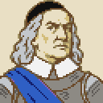 | Peter Stuyvesant | Trade | Custom Houses can be built, selling goods without ships. | 1492 to 1600, 1600 to 1700, after 1700 |
| 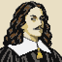 | Jan de Witt | Trade | Trade with foreign colonies; fuller Foreign Affairs report. | 1492 to 1600, 1600 to 1700, after 1700 |
| 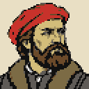 | Ferdinand Magellan | Exploration | Ships move one square farther; Atlantic crossings are never slow. | 1492 to 1600, 1600 to 1700, after 1700 |
| 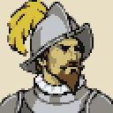 | Francisco Coronado | Exploration | Every colony on the map and its surroundings are revealed. | 1492 to 1600, 1600 to 1700, after 1700 |
| 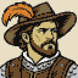 | Hernando de Soto | Exploration | Scouts never return from a rumor empty-handed; every unit sees one square farther. | 1492 to 1600, 1600 to 1700, after 1700 |
| 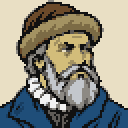 | Henry Hudson | Exploration | Fur trappers bring in twice the furs. | 1492 to 1600, 1600 to 1700 |
|  | Sieur De La Salle | Exploration | Every colony of three or more gets a Stockade. | 1492 to 1600, 1600 to 1700, after 1700 |
| 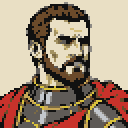 | Hernan Cortes | Military | Conquered settlements always yield treasure, more of it, and the Crown ships it for the tax alone. | 1492 to 1600, 1600 to 1700, after 1700 |
|  | George Washington | Military | Soldiers and dragoons that win a battle are always promoted. | 1600 to 1700, after 1700 |
| 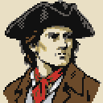 | Paul Revere | Military | A colony with no soldier arms a colonist from its muskets when attacked. | 1492 to 1600, 1600 to 1700, after 1700 |
| 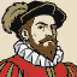 | Francis Drake | Military | Privateers fight half again as well. | 1492 to 1600, 1600 to 1700, after 1700 |
| 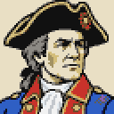 | John Paul Jones | Military | A Frigate sails from Europe to join the fleet. | 1600 to 1700, after 1700 |
| 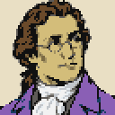 | Thomas Jefferson | Political | Liberty bell production rises by half. | 1492 to 1600, 1600 to 1700, after 1700 |
|  | Pocahontas | Political | All native tension is forgotten, and alarm grows half as fast. | 1492 to 1600, 1600 to 1700, after 1700 |
| 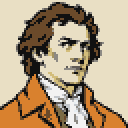 | Thomas Paine | Political | Liberty bell production rises by the tax rate. | 1492 to 1600, 1600 to 1700, after 1700 |
| 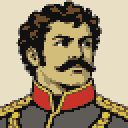 | Simon Bolivar | Political | Sons of Liberty membership rises by 20 points in every colony. | 1600 to 1700, after 1700 |
| 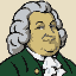 | Benjamin Franklin | Political | The King's wars in Europe no longer reach the colonies; rivals ask less in negotiations. | 1492 to 1600, 1600 to 1700, after 1700 |
| 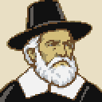 | William Brewster | Religious | No criminals or servants emigrate, and you choose who comes. | 1492 to 1600, 1600 to 1700, after 1700 |
| 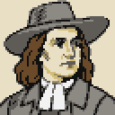 | William Penn | Religious | Preachers produce half again as many crosses. | 1492 to 1600, 1600 to 1700, after 1700 |
| 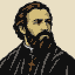 | Jean de Brebeuf | Religious | Every mission, standing or new, works as a Jesuit mission. | 1492 to 1600, 1600 to 1700, after 1700 |
|  | Juan de Sepulveda | Religious | Natives of defeated settlements more often convert and join you. | 1492 to 1600, 1600 to 1700, after 1700 |
|  | Bartolome de las Casas | Religious | Every Indian convert, in a colony or out, becomes a Free Colonist. | 1600 to 1700, after 1700 |

<!-- /table -->

## Using them by field

### Trade

The trade fathers pay off once your colonies make and sell goods in quantity. Peter Minuit is worth most at the very start, while you are still buying land for new colonies from the natives, and the Congress stops offering him after 1700. Adam Smith lets you build factories, the last step of each workshop, which make half again the goods from the same raw materials. Peter Stuyvesant brings the Custom House, which sells goods without a ship sailing to Europe. Jakob Fugger lifts every boycott at once, which matters if you have thrown cargo in the harbour more than once. Jan de Witt opens trade with the other powers' colonies and fills out the Foreign Affairs report (see [[Other Powers]]).

### Exploration

Henry Hudson and Hernando de Soto pay most while there is still country to explore and furs to take: Hudson doubles the furs your trappers bring in (and is not offered after 1700), and de Soto lets every unit see one square farther and makes every rumor your scouts explore give something. Sieur De La Salle gives a Stockade to every colony of three or more, now and later. That protects them, but a colony with a Stockade cannot be taken below three colonists, so think before you seat him if you like small colonies you can empty. Francisco Coronado shows you every colony on the map and the country around it. Ferdinand Magellan gives your ships one more square of movement and spares them the occasional slow crossing to Europe, which adds up over a long game of trade.

### Military

Paul Revere protects a colony with no soldier by arming one of its colonists from the muskets in store when it is attacked. George Washington promotes every soldier and dragoon who wins a battle, which builds veterans quickly in a war. Francis Drake strengthens privateers; John Paul Jones sends you a Frigate from Europe. Hernan Cortes makes conquered native settlements give more treasure, and has the Crown carry it home for the tax alone. Choose these when war is coming, or when you mean to start one.

### Political

The political fathers are the road to independence. Thomas Jefferson raises bell production by half, and Thomas Paine raises it by the tax rate, so Paine is worth more late in the game when taxes are high. Simon Bolivar raises Sons of Liberty membership in every colony at once. Pocahontas wipes away all native anger at you and slows it from then on, a way out of a war with a tribe you did not want. Benjamin Franklin keeps the King's wars in Europe from reaching your colonies and makes rival powers ask less of you (see [[Other Powers]]).

### Religious

The religious fathers shape who comes to your colonies. William Brewster stops criminals and servants from emigrating and lets you choose each new colonist from the docks. William Penn raises the crosses preachers make by half, so colonists come over sooner. Jean de Brebeuf makes every mission work as a Jesuit mission. Juan de Sepulveda brings more converts from settlements you defeat, and Bartolome de las Casas turns every Indian convert into a Free Colonist. These help most in a game with many colonies and many missions (see [[Native Peoples]]).
