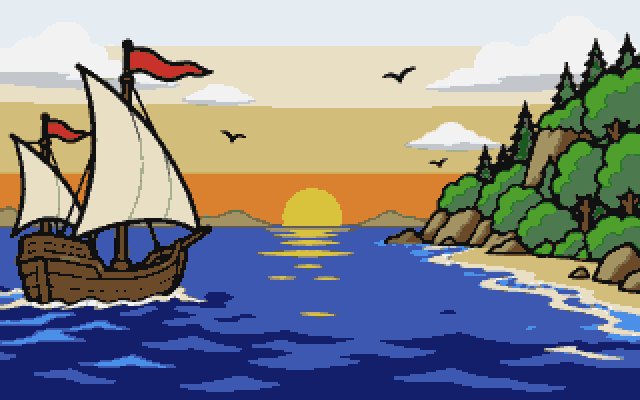
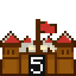
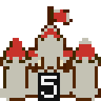
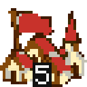
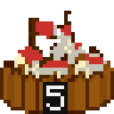
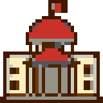
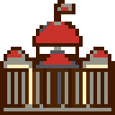

The pictures in New World are the game's own, made for it. Each began as a large picture of one thing: a unit, a building, a stretch of ground. To go into the game it is cut from its plain background and shrunk, square by square, into a few colours, so that every sprite on the map belongs with the others. The units, the settlements, the buildings and the goods each share one set of colours per group; a stretch of ground keeps a few flat colours of its own. The portraits and the title painting use only the 32 colours of the map. Where a picture is painted bright cyan, the game fills it with the owner's colour when it draws it.

The faces in the portraits are invented. None is a likeness of a real person.

Each painting is on the left and the sprite it became is beside it, blown up without smoothing so you can see its squares.

## Title

| Painting | Sprite |
| :---: | :---: |
|  |  |

The painting that hangs behind the title screen, shrunk to 320 by 200 squares.

## Units

One painting for each kind of unit, on land and at sea.

| Painting | Sprite | What it is |
| :---: | :---: | :--- |
|  |  | Armed Braves |
|  |  | Artillery |
|  |  | Braves |
|  |  | Caravel |
|  |  | King's Cavalry |
|  |  | Colonist |
|  |  | Continental Army |
|  |  | Continental Cavalry |
|  |  | Damaged Artillery |
|  |  | Dragoon |
|  |  | Frigate |
|  |  | Galleon |
|  |  | Man-O-War |
|  |  | Merchantman |
|  |  | Missionary |
|  |  | Mounted Braves |
|  |  | Mounted Warriors |
|  |  | Pioneer |
|  |  | Privateer |
|  |  | King's Regular |
|  |  | Scout |
|  |  | Soldier |
|  |  | Treasure Train |
|  |  | Wagon Train |

## Colonies and settlements

A colony is drawn by how well it is walled, a native settlement by how its people build. In play the roofs and flags take the owner's colour.

| Painting | Sprite | What it is |
| :---: | :---: | :--- |
|  |  | A colony with a fort |
|  |  | A colony with a fortress |
|  |  | A colony with no walls |
|  |  | A colony behind a stockade |
|  |  | An Aztec city |
|  |  | A camp of a wandering people |
|  |  | An Inca city |
|  |  | A village of longhouses |

## Forests, hills and mountains

The trees and heights that stand on a square. In play each is drawn over the ground of its square, so the sprite shows both.

| Painting | Sprite | What it is |
| :---: | :---: | :--- |
|  |  | Boreal Forest |
|  |  | Broadleaf Forest |
|  |  | Conifer Forest |
|  |  | Hills |
|  |  | Mixed Forest |
|  |  | Mountains |
|  |  | Rain Forest |
|  |  | Scrub Forest |
|  |  | Tropical Forest |
|  |  | Wetland Forest |

## Ground

One ground for each open terrain and for the sea. Hills and mountains have a ground of their own under their heights.

| Painting | Sprite | What it is |
| :---: | :---: | :--- |
|  |  | Arctic |
|  |  | Desert |
|  |  | Grassland |
|  |  | Hills |
|  |  | Marsh |
|  |  | Mountains |
|  |  | Ocean |
|  |  | Plains |
|  |  | Prairie |
|  |  | Savannah |
|  |  | Sea Lane |
|  |  | Swamp |
|  |  | Tundra |

## Buildings

The buildings of the colony screen. These and the goods are drawn from plain shapes rather than painted.

| Painting | Sprite | What it is |
| :---: | :---: | :--- |
|  |  | Armory |
|  |  | Arsenal |
|  |  | Blacksmith's House |
|  |  | Blacksmith's Shop |
|  |  | Capitol |
|  |  | Capitol Expansion |
|  |  | Carpenter's Shop |
|  |  | Cathedral |
|  |  | Church |
|  |  | Cigar Factory |
|  |  | College |
|  |  | Custom House |
|  |  | Docks |
|  |  | Drydock |
|  |  | Fort |
|  |  | Fortress |
|  |  | Fur Factory |
|  |  | Fur Trader's House |
|  |  | Fur Trading Post |
|  |  | Iron Works |
|  |  | Lumber Mill |
|  |  | Magazine |
|  |  | Newspaper |
|  |  | Printing Press |
|  |  | Rum Distiller's House |
|  |  | Rum Distillery |
|  |  | Rum Factory |
|  |  | Schoolhouse |
|  |  | Shipyard |
|  |  | Stable |
|  |  | Stockade |
|  |  | Textile Mill |
|  |  | Tobacconist's House |
|  |  | Tobacconist's Shop |
|  |  | Town Hall |
|  |  | University |
|  |  | Warehouse |
|  |  | Warehouse Expansion |
|  |  | Weaver's House |
|  |  | Weaver's Shop |

## Goods

One icon for each good, and for hammers, crosses and liberty bells.

| Painting | Sprite | What it is |
| :---: | :---: | :--- |
|  |  | Liberty Bells |
|  |  | Cigars |
|  |  | Cloth |
|  |  | Coats |
|  |  | Cotton |
|  |  | Crosses |
|  |  | Food |
|  |  | Furs |
|  |  | Hammers |
|  |  | Horses |
|  |  | Lumber |
|  |  | Muskets |
|  |  | Ore |
|  |  | Rum |
|  |  | Silver |
|  |  | Sugar |
|  |  | Tobacco |
|  |  | Tools |
|  |  | Trade Goods |

## Portraits

The advisers who write your reports, the King, and every founding father. The faces are invented; none is a likeness of a real person.

| Painting | Sprite | What it is |
| :---: | :---: | :--- |
|  |  | Adam Smith |
|  |  | The advisers (the reports on colonies, labor, trade, the fleet, the natives and religion) |
|  |  | Bartolome de las Casas |
|  |  | Benjamin Franklin |
|  |  | The Continental Congress |
|  |  | Ferdinand Magellan |
|  |  | Foreign Affairs |
|  |  | Francis Drake |
|  |  | Francisco Coronado |
|  |  | George Washington |
|  |  | Henry Hudson |
|  |  | Hernan Cortes |
|  |  | Hernando de Soto |
|  |  | Jakob Fugger |
|  |  | Jan de Witt |
|  |  | Jean de Brebeuf |
|  |  | John Paul Jones |
|  |  | Juan de Sepulveda |
|  |  | The King |
|  |  | Sieur De La Salle |
|  |  | Paul Revere |
|  |  | Peter Minuit |
|  |  | Peter Stuyvesant |
|  |  | Pocahontas |
|  |  | The chronicler (the Colonial Score and the Hall of Fame) |
|  |  | Simon Bolivar |
|  |  | Thomas Jefferson |
|  |  | Thomas Paine |
|  |  | William Brewster |
|  |  | William Penn |

## The chart

The part of the map you have not explored is drawn as an old explorer's chart. These pictures are drawn at their final size in six inks of the map's colours, so there is no larger painting behind them. Each comes in three sizes, one for each zoom of the map: 32, 16 and 8 pixels to a square.

| What it is | 32 | 16 | 8 |
| :--- | :---: | :---: | :---: |
| The vellum the unexplored map is drawn on |  |  |  |
| The compass rose |  |  |  |
| A sea serpent |  |  |  |
| A ship |  |  |  |
