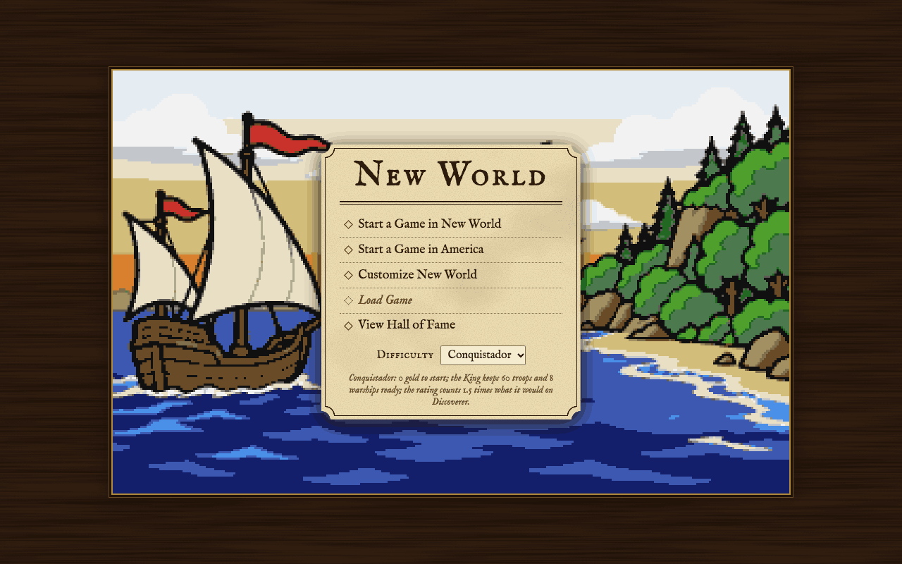
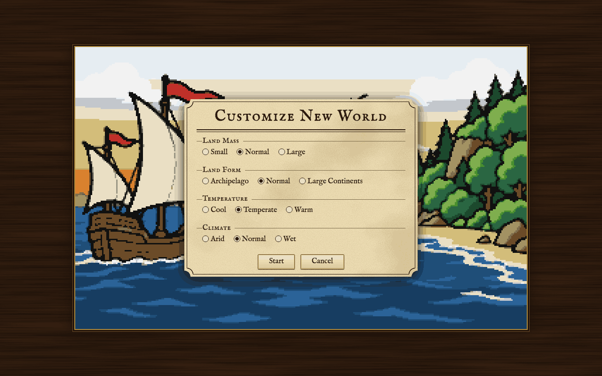
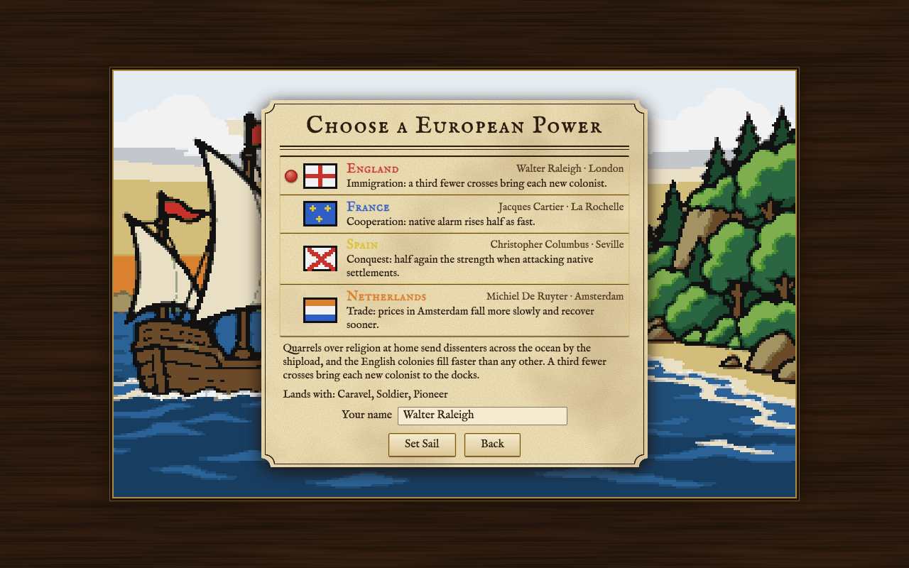
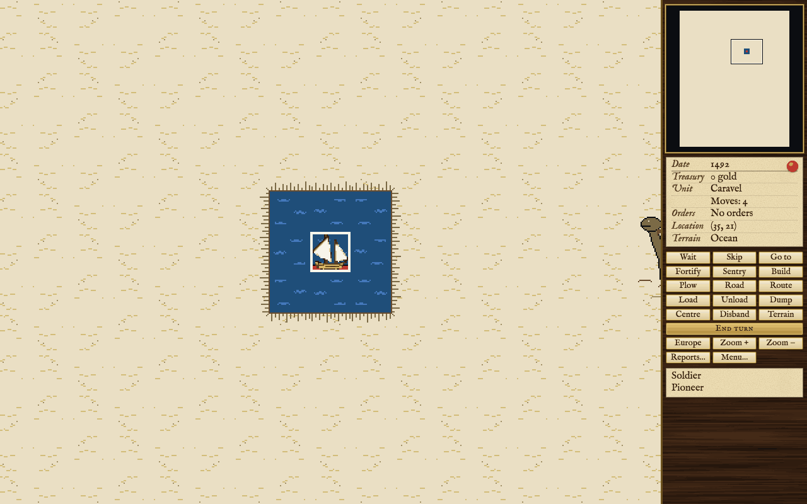

How to start a new game, choose a power and a difficulty, and play your first turns.

## The title screen

The game opens on the title screen. It offers five choices:

- **Start a Game in New World**: a new game on a new map, made up for this game.
- **Start a Game in America**: a new game on a map of the Americas, from Newfoundland down through the Caribbean to Brazil, with the native peoples where they lived.
- **Customize New World**: set the kind of map you want first, then start.
- **Load Game**: carry on a saved game. It is greyed out until there is a game to load. When there is only the game you were last playing, it goes straight back to it; otherwise it shows the save slots (see [[Help and Options]]).
- **View Hall of Fame**: the ten best games finished in this browser (see [[Score and Hall of Fame]]).

Under the choices is the **Difficulty** for the next new game, with a line saying what the chosen level means. The level is fixed for the whole game.

## New World, America or Customize

**New World** makes a fresh map every game: you never know where the coast lies or who lives inland. **America** is the same map every time, drawn after the real continents, so you can plan where to land. Both play by the same rules.

**Customize New World** lets you shape the made-up map before it is made. There are four settings, three choices each, and the middle one is what New World uses:

- **Land Mass**: Small, Normal or Large. How much of the map is land.
- **Land Form**: Archipelago, Normal or Large Continents. Many islands, or a few great land masses.
- **Temperature**: Cool, Temperate or Warm. Shifts the whole map toward colder or warmer terrain.
- **Climate**: Arid, Normal or Wet. Drier or wetter terrain, with less or more forest.

**Start** goes on to choosing a power; **Cancel** goes back to the title. [[The Map]] describes the terrain these settings shape.

## Difficulty

There are five levels, from Discoverer, the gentlest, to Viceroy, the hardest. A harder level gives you less gold to start, makes the King's army larger, makes the natives warier and taxes rise faster, and counts your score for more. Conquistador, the middle level, is chosen at first.

<!-- table: difficulty-levels -->

| Level | Starting gold | The Crown's starting force | Rating factor (per hundred) | In short |
| :--- | :--- | :--- | :--- | :--- |
| Discoverer | 1000 | 15 regulars, 5 cavalry, 2 artillery, 2 warships | 4 | Discoverer: 1000 gold to start; the King keeps 22 troops and 2 warships ready; the rating counts 1 times what it would on Discoverer. |
| Explorer | 300 | 23 regulars, 10 cavalry, 8 artillery, 5 warships | 5 | Explorer: 300 gold to start; the King keeps 41 troops and 5 warships ready; the rating counts 1.25 times what it would on Discoverer. |
| Conquistador | 0 | 31 regulars, 15 cavalry, 14 artillery, 8 warships | 6 | Conquistador: 0 gold to start; the King keeps 60 troops and 8 warships ready; the rating counts 1.5 times what it would on Discoverer. |
| Governor | 0 | 39 regulars, 20 cavalry, 20 artillery, 11 warships | 8 | Governor: 0 gold to start; the King keeps 79 troops and 11 warships ready; the rating counts 2 times what it would on Discoverer. |
| Viceroy | 0 | 47 regulars, 25 cavalry, 26 artillery, 14 warships | 10 | Viceroy: 0 gold to start; the King keeps 98 troops and 14 warships ready; the rating counts 2.5 times what it would on Discoverer. |

<!-- /table -->

The two gentlest levels are kinder in other ways too: colonies do not starve to death before 1520, the game warns you about a poor colony site, and your soldier starts as a veteran.

## Choosing a power

Every new game passes through **Choose a European Power**. Four powers are colonizing the New World, and you lead one of them; the other three are played by the computer. Each power has one strength, and lands with a ship, a soldier and a pioneer. Pick a power with the mouse, or with Up and Down (or 1 to 4). The screen shows a short account of the power and exactly what it lands with at the difficulty you chose.

<!-- table: nations -->

| Power | Good at | Home port | Its colonies are called | Lands with (Discoverer, Explorer) | Lands with (Conquistador, Governor, Viceroy) |
| :--- | :--- | :--- | :--- | :--- | :--- |
| England | Immigration: a third fewer crosses bring each new colonist. | London | New England | Caravel, Veteran Soldier, Pioneer | Caravel, Soldier, Pioneer |
| France | Cooperation: native alarm rises half as fast. | La Rochelle | New France | Caravel, Veteran Soldier, Hardy Pioneer | Caravel, Soldier, Hardy Pioneer |
| Spain | Conquest: half again the strength when attacking native settlements. | Seville | New Spain | Caravel, Veteran Soldier, Pioneer | Caravel, Veteran Soldier, Pioneer |
| Netherlands | Trade: prices in Amsterdam fall more slowly and recover sooner. | Amsterdam | New Netherlands | Merchantman, Veteran Soldier, Pioneer | Merchantman, Soldier, Pioneer |

<!-- /table -->

England fills its colonies fastest, because fewer crosses bring each new colonist. France keeps the peace with the natives most easily. Spain is the strongest at war with the natives. The Netherlands is the trader: its prices hold up longest, and it starts with a Merchantman, which carries more than a Caravel. If you are not sure, England or the Netherlands is a forgiving first choice.

Below the powers is **Your name**, filled in with the power's own leader. Type your own if you like; it is the name the game uses for you and the name that goes into the Hall of Fame. **Set Sail** starts the game; **Back** returns to the screen you came from. [[Other Powers]] says how the three rivals behave.

## The audience with the Crown

A new game opens with an audience. Your monarch names you Viceroy of the New World and sends you across the ocean to settle the land and send its wealth home. Choose **So be it** to begin. The game does not show the audience again when you load a saved game.

## Your first turns

This walkthrough follows a typical opening. Each step names the page that says more.

### Sail west

You start in 1492 on the open sea, at the east side of the map. Your ship is the active unit, with the soldier and pioneer aboard, and almost all of the map is still unexplored. Land most likely lies to the west: press the left arrow (or click the square to the left of the ship) to sail. A Caravel moves four squares a turn. Each square the ship passes reveals the country around it. [[The Map]] explains the terrain you find and [[Controls]] lists every way to move.

### Make landfall

When land lies alongside, steer the ship at the shore. The game asks whether the passengers should stay aboard or **Make landfall**. Landfall moves nobody: the ship stays where it is and its passengers wake, the first of them now the active unit. Move each one onto the land yourself, with the arrow key or a click on the square. Stepping ashore ends that unit's turn. Then click the unit on land that is to found the colony, to make it the active unit again.

### Found a colony

A good first site is beside the sea, so ships can call, with open land and forest around it. Food matters most: grassland, plains, prairie and savannah grow it well, and ocean squares give fish. When a unit stands on the square you want, press **B** (or the **Build** button). The game suggests a name, which you can change. You cannot found one on mountains or right beside another colony. Founding is immediate. Whatever the founder carried, muskets or tools, goes into the colony's warehouse. [[Colonies]] covers choosing a site in full.

### Put colonists to work

Founding opens the colony screen. The founder is already at work on one of the eight squares around the colony. The colony square itself also yields food and one other crop for free. Click a colonist, then a square in the **Area** or a building in the **Settlement**, to set him to work there (or drag him). Click him again for a menu of jobs.

Every colonist eats two food a turn, so make sure the colony grows at least as much as it eats. The **People** panel shows the food made, eaten and stored. Bring the other units in from the gates the same way, or keep the soldier outside on guard and the pioneer working the land. Press **Esc** to leave. [[Colonies]] and [[Buildings]] explain production; [[Units]] explains what the soldier and the pioneer are for.

### Send the ship home with cargo

Once a colony has goods to sell, such as furs, sugar, tobacco or lumber, bring the ship into its port. On the colony screen, drag goods from the warehouse into the ship's hold in the **Transport** panel. Back on the map, press **G** (Go to): a ship that can reach the Sea Lane is offered Europe first. Or sail east into the Sea Lane at the edge of the map, and the game asks whether to sail for Europe. The crossing takes a couple of turns each way.

When the ship has arrived in your home port, press **E** or the **Europe** button to open the Europe screen. Sell the cargo, buy what the colonies lack, and pick up anyone waiting on the docks. Then choose **Set sail** to send the ship back to the New World. [[Europe and Trade]] covers prices and taxes.

### Recruit

Colonists come forward on the docks by themselves as your colonies make crosses. With gold in hand you need not wait: in Europe, **Recruit** pays for one of the three people waiting, and **Train** buys a skilled specialist. Both board the next ship. Early on, more colonists mean more of everything.

### And then

Explore inland with the soldier or a scout to meet the native peoples and look into rumors of lost cities ([[Native Peoples]]). Have the pioneer clear, plow and build roads. Found a second colony. Keep an eye on the treasury, and on the bells your statesmen ring. [[The Crown and Independence]] describes the long game.

## What the sidebar shows

The sidebar on the right of the map holds four things, top to bottom:

- **The New World view**: the whole map in small, with a frame around the part on screen. Click it to look somewhere else.
- **The status panel**: the date, your treasury, and the active unit: its type, the moves it has left, its orders, where it stands and the terrain there. Anything special about that square, such as a river, a road or a resource, is listed too.
- **The buttons**: every order a unit can be given (Wait, Skip, Go to, Fortify, Sentry, Build, Plow, Road, Route, Load, Unload, Dump, Centre, Disband, Terrain), **End turn**, **Europe**, zoom, **Reports...** and **Menu...**. You can play the whole game with these and the mouse.
- **The cargo list**: what a ship or wagon train is carrying, or who is aboard.

## How a turn ends

Each turn you give orders to your units one at a time; the game moves on to the next unit as each one finishes. When every unit has moved, the game waits for you to press **Enter** or the **End turn** button. That pause lets you look around, open colonies or visit Europe first. You can end a turn early at any time the same way. If you would rather the turn end by itself after the last order, turn off **End of turn** in the game options ([[Help and Options]]). Then the other powers and the native peoples move, your colonies produce, and the next turn begins. The year goes up by one a turn until 1600, and after that there are two turns a year, spring and autumn.

## How to save

With **Autosave** on (it is on at first), the game keeps itself in your browser as you play: close the tab and **Load Game** brings you back to where you were. To keep a game at a particular point, press **Alt+L** (or **Menu...** then **Save or load a game**) and save it in one of the eight slots of your own (the other two of the ten are the autosaves). You can also export a game to a file. [[Help and Options]] covers saving and loading in full.
