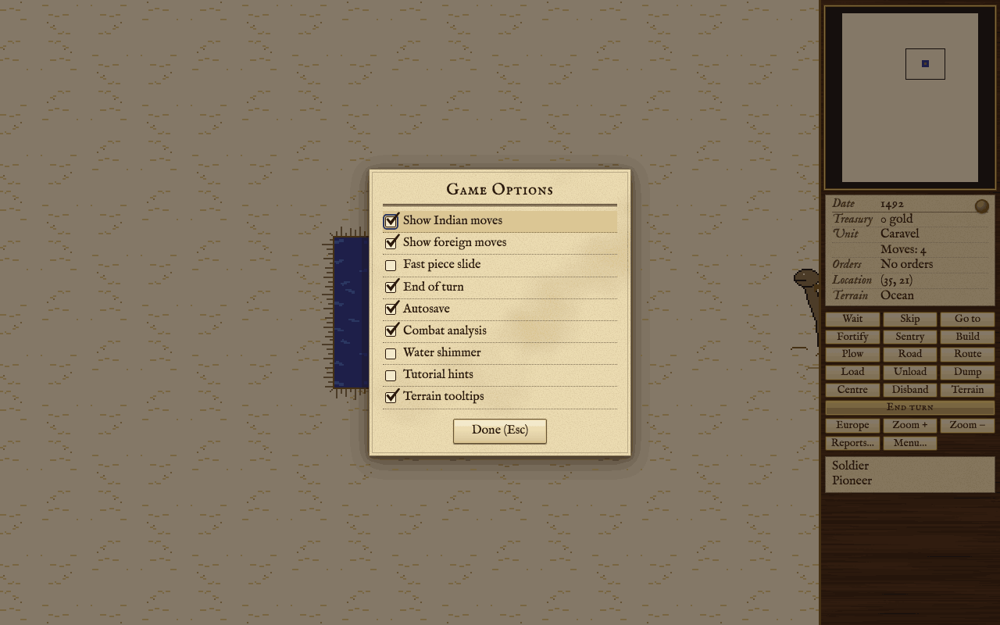
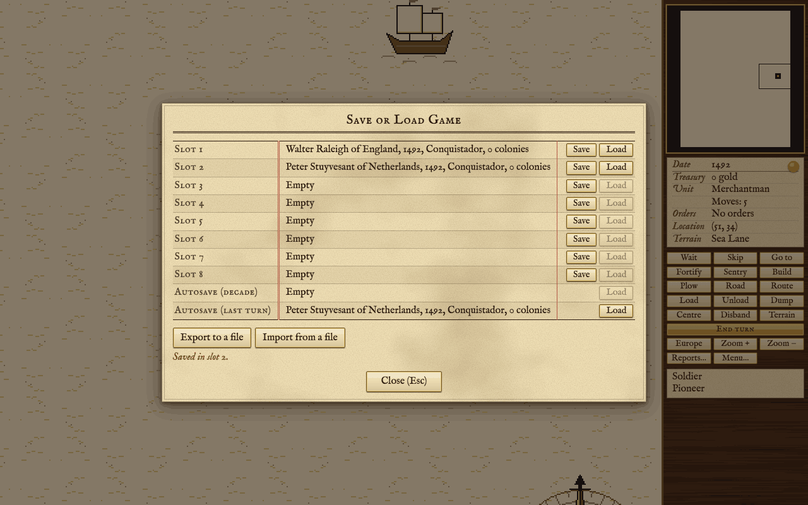
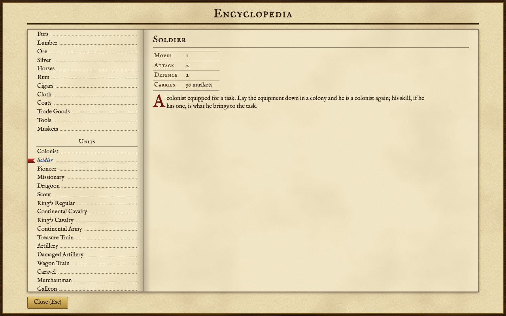

The options, saving and loading, the hints, the encyclopedia, the tooltips and the cheats.

## Options

There are three groups of options, each in its own dialog:

- **Game options** (Alt+G): how the game plays and what it tells you.
- **Colony report options** (Alt+O): labels on the colony screen, and which kinds of colony news reach the log.
- **Sound options** (Alt+S): music and sound effects.

Open them from the keyboard, or with **Menu...** in the sidebar. Each option is a check box, and a change takes effect at once. **Done** (or Esc) closes the dialog. Hold the pointer over an option to see what it does. Options are kept in your browser and apply to every game you play there.

<!-- table: options -->

### Game options

| Option | What it does | At first |
| :--- | :--- | :--- |
| Show Indian moves | Note in the log what native units were seen doing between our turns. | On |
| Show foreign moves | Note in the log what foreign units were seen doing between our turns. | On |
| Fast piece slide | Pieces move at once instead of sliding. | Off |
| End of turn | Wait for Enter when every unit has moved, instead of ending the turn at once. | On |
| Autosave | Keep the game in this browser after every action. | On |
| Combat analysis | Show the odds and ask before an attack. | On |
| Water shimmer | Animate the sea. | On |
| Tutorial hints | Advice in the log at the moments a newcomer needs it. | On |
| Terrain tooltips | Describe the square under the pointer: its terrain, features and yields, and the units on it. | On |

### Colony report options

| Option | What it does | At first |
| :--- | :--- | :--- |
| Labels on buildings | Name each building on the colony screen. | On |
| Labels on cargo and terrain | Name each cargo and what each square yields. | On |
| Report when colonists are trained | A line when a colonist is taught a trade at school, or learns one by doing it. | On |
| Report food shortages | A warning when a colony's food will run out in a few turns, and when the last of it is eaten. | On |
| Report raw materials shortages | A warning when work stops in a building for want of the goods it works up. | On |
| Report tools needed for production | A warning when what a colony is building needs more tools than it has. | On |
| Report inefficient government | A warning when Tory feeling slows every worker in a colony, and a line when it no longer does. | On |
| Report new cargos available | A line when a colony has a full load of a good ready to ship, and when its warehouse cannot hold all of a good. | On |
| Report Sons of Liberty membership | A line when a colony's Sons of Liberty membership rises or falls. | On |
| Report rebel majorities | A line when half or all of a colony stands with the Sons of Liberty, and when it slips back and a production bonus is lost. | On |

### Sound options

| Option | What it does | At first |
| :--- | :--- | :--- |
| Background music | A quiet tune made up as it goes, in an old mode. | Off |
| Event music | A short flourish when something is built, someone arrives, or the drums of war sound. | On |
| Sound effects | Footfalls, gunfire, the turn of the year. | On |

<!-- /table -->

Some news is always reported, whatever the colony report options say: a colonist starving, a building finished and a unit finished.

**Sound.** Every sound is made by the browser as the game plays; nothing recorded is shipped. There are six cues: a footfall when a unit of yours moves, gunfire for a fight you are in, a flourish when a colony finishes a building or a unit, a ship's bell when an immigrant comes forward, a rising figure as your turn begins, and drums when a native people turns to war against you, burns one of your colonies or joins the Crown. The background music, if you turn it on, is made up phrase by phrase as you play.

## Saving and loading

Press **Alt+L** (or **Menu...** then **Save or load a game**) to open **Save or Load Game**. It has ten slots:

- **Slots 1 to 8** are yours. **Save** writes the game as it stands into a slot; **Load** brings a saved game back. Each slot shows who was playing, the date in the game, the difficulty and how many colonies there were.
- **Autosave (decade)** holds a copy of the game from the start of the latest decade (a year ending in nought). Use it to go back a few turns.
- **Autosave (last turn)** is the game as it stands, written as you play. When it is the only save there is, **Load Game** on the title screen goes straight to it.

The two autosave slots are kept only while the **Autosave** game option is on (it is on at first). You cannot save into them yourself.

Loading replaces the game in front of you; nothing is merged. A save that will not load says why: it is not a saved game, it was saved by a newer version of the game, it is too old to be read, or it is incomplete or damaged.

**Files.** **Export to a file** downloads the game as a `.json` file, and **Import from a file** loads one. Use files to keep a game safe, to move it to another browser or computer, or to send it to someone.

**Where saves live.** Saves, options and the Hall of Fame are kept in your browser's storage for this site, and nowhere else. Nothing is sent to a server. Clearing the browser's data for the site (cookies and site data) deletes them, and a private window may forget them when it closes. Another browser, or another computer, does not see them. Export a file of any game you want to be sure of keeping.

## Hints

While **Tutorial hints** is on, the game gives advice at the moments a newcomer needs it: when your ship first sees land, when a good colony site is underfoot, when a colony eats more than it grows, when a pioneer could build a road, the first time you open Europe, and so on. There are nineteen such hints. Each is given once a game, in the log beside the map, set apart from the news. They never stop play or ask a question. To turn them off, open the game options (Alt+G) and clear **Tutorial hints**.

The log itself keeps the last 200 lines of news and hints, and scrolls.

## The encyclopedia

The encyclopedia (**Alt+P**, or **Menu...** then **Encyclopedia**) has a page for everything in the game, grouped by kind: cargo, units, terrain, skills, buildings, Founding Fathers and twelve concepts such as prices, taxes, liberty bells and crosses. Each page gives the facts from the game's own rule tables and a short note on what the thing is for.

**Right-click** anything to open the encyclopedia at its page: a unit or the terrain on the map (squares you have explored), or a building, a cargo or a colonist on the colony screen.

## Tooltips

Hold the pointer over a map square to see a slip describing it: the terrain, any river, road, plowing, resource or rumor, what a colonist working it would bring in, the cost of moving onto it and its value in defence. Where the map shows a unit on the square the slip names it underneath: each of your own units with its moves, its orders and what it carries, and for an armed or equipped colonist the skill under the equipment in brackets ("Soldier (Expert Farmer)"), or whose the unit of another power is and its kind. Turn the **Terrain tooltips** game option off if you would rather not see it; the same facts for the active unit's square stay in the sidebar, and **F1** (Terrain Information) lists every kind of terrain.

Elsewhere, hold the pointer over a sidebar button to see its name and key, over an option to see what it does, and over the Europe button to see which of your ships are in port there or crossing, and when each arrives. [[Controls]] lists every key; [[Reports and Advisers]] describes the reports.

## Cheats

The game has a cheat console, for fun and for trying things out. It is not part of the game proper, and nothing in play needs it.

Press **Alt+C** (or **Menu...** then **Cheats**) while the game is being played to open it; a game that has ended does not open it. Type a line and press **Enter**: the game does what the line says at once. A line the game cannot carry out stays in the box with the reason under it; one it accepts is cleared, and a sentence saying what was done joins the list above the box and the log beside the map, where it begins "Cheat:". **Tab** finishes the word you are typing, or lists the words that would fit when there are several; on an empty line it moves on to **Done**. **Up** and **Down** bring back the lines accepted since you opened the console, and **Esc** (or **Done**) closes it. The console stays open between lines, so you can give several one after another, and its **Commands** sheet lists every cheat with an example.

**A cheated game is marked.** Once a cheat has been used, the game is marked for good, and the mark is kept in the save. The game plays on unchanged, is scored as any other and can enter the Hall of Fame, but its score report says "Cheats were used in this game." and its line in the Hall of Fame reads "cheated" after the leader's name. No cheat undoes another or takes the mark off. See [[Score and Hall of Fame]].

### How a line is written

A line is the cheat's name followed by what it needs. Below, `<angle brackets>` mark something you must give and `[square brackets]` something you may leave out.

- **For another power.** Begin the line with `as` and a power to cheat for that power instead of your own: `as france gold 2000`. Every cheat takes it, and both that power and yours are marked.
- **An amount** adds, takes or sets: `500` or `+500` adds 500, `-200` takes 200 away, and `=1000` sets the figure to 1000. **A count** is a whole number, nought or more. **A percent** is 0 to 100. A line that would leave less than nothing of anything is refused, not rounded.
- **A square** is its column and row with a comma between, `12,30`, or `here` for the square of the active unit. **A place** is a square, `here`, `europe`, or one of your colonies by name.
- **A thing is named** by its name or by the start of it, in capitals or not: `jamest` for Jamestown, `farmer` for an Expert Farmer, `smith` for Adam Smith. The start of any word of the name will do, as long as only one thing fits; if several fit, the line is refused and they are listed. Put a name with spaces in quotes: `"New Amsterdam"`. A unit may also be `active`, the one whose turn it is to move. `here` and `active` need an active unit; without one the line is refused.
- A colony, a unit or a settlement named in a cheat must be the power's own, or concern it.

### The cheats

**Treasury and Congress**

| Line | What it does |
| :--- | :--- |
| `gold [amount]` | Adds to the treasury, takes from it or sets it. With no amount: adds 1000. |
| `crosses [count]` | Adds crosses toward the next immigrant. With no count: 100. |
| `bells [count]` | Adds liberty bells. Before the Declaration they count toward the next Founding Father, who may join at once; if the Congress convenes, its choice of names is put to you there and then. After it they count toward help from abroad. With no count: 100. |
| `father <father>` | Seats a Founding Father in your Congress at once. The bells gathered toward the next one are lost, as when a Father joins in the ordinary way. Refused if he already sits there. |
| `tax <percent>` | Sets the tax rate, from 0 to 75. |
| `boycott lift` | Lifts every boycott, with nothing to pay. |

**The map**

| Line | What it does |
| :--- | :--- |
| `reveal [square] [radius]` | With nothing after it: makes the whole map known. With a square: the squares within that radius of it (3 if none is given). |
| `terrain <square> <terrain>` | Changes the ground of a square. Hills and mountains are raised on the land that is there, and are refused on water. A square turned to water loses its road, plowing, river, resource and rumor, and land that is no longer open loses its plowing. Refused under a colony or a settlement, and under a unit that could not stand on the new ground. |
| `road <square> on\|off` | Lays or lifts a road. Refused on water. |
| `plow <square> on\|off` | Plows a square or lets it go back. Needs open land. |
| `river <square> none\|minor\|major` | Sets the river on a square. Refused on water. |
| `resource <square> <resource>\|none` | Puts a special resource on a square whose terrain suits it, or with `none` takes away the one there. |
| `rumor <square> on\|off` | Places or removes a rumor of a lost city. Refused on water, and `on` is refused under a colony or a settlement. |

**Units**

| Line | What it does |
| :--- | :--- |
| `spawn <unitType> [profession] [place]` | Makes a new unit, ready to move. A colonist may be given a profession (a free colonist otherwise); other units take none. With no place it appears on the active unit's square. *At a square*: a land unit on land, a ship on water or in your own colony; refused on a settlement, on another power's colony and on a square with someone else's units. *In a colony* named: a colonist joins it and goes to work (a soldier's muskets or a pioneer's tools go to the warehouse), unless the colony is full; any other unit stands on its square. *In `europe`*: a ship lies in port and anyone else waits on the docks; refused once Europe is closed to you, and for a wagon train, which no ship carries. A pioneer carries a full set of tools, and a treasure train 1000 gold. Native units and damaged artillery cannot be made. |
| `teleport <unit> <square>` | Moves one of your units on the map to a square, with everything aboard it, keeping its moves. Its standing orders are dropped, except a trade route. The square must be one it could be spawned on. Refused for a unit in Europe, on the crossing or aboard a ship. |
| `moves <unit>` | Gives a unit its moves for the turn back. Refused for a unit that is not on the map and for a ship under repair. |
| `repair <unit>` | Makes a ship under repair sound at once, wherever she lies. Refused for anything else. |
| `promote <unit>` | Makes a soldier or a dragoon a veteran. Refused for anything else, and for one who already is. |

**Colonies**

| Line | What it does |
| :--- | :--- |
| `goods <colony> <good>\|all <amount>` | Adds to, takes from or sets one cargo in the warehouse, or with `all` every one of the sixteen. The warehouse may be left over-full; what it cannot hold spoils at the end of the turn as usual. No cargo may be left above 100000. |
| `hammers <colony> <amount>` | Adds to, takes from or sets the hammers the colony has put by, to 100000 at most. |
| `finish <colony>` | Gives the colony the hammers and tools its present project still lacks, at no cost in gold. The project is completed in the ordinary way when your next turn opens. Refused if nothing is being built, if the building already stands, and if nothing is lacking. |
| `building <colony> <building>` | Puts up a building at once, with any earlier ones of its line the colony lacks (a fortress brings the stockade and the fort). The colony's size, the coast and any Founding Father the building would need are ignored. Refused if the colony has it. Only buildings the game offers in play can be named. |
| `liberty <colony> <percent>` | Sets Sons of Liberty membership in the colony, so that the colony reads the percent given; it drifts on from there as in any colony. The production bonus follows over the next turns, one step a turn. |

**Natives, powers, the Crown and the market**

| Line | What it does |
| :--- | :--- |
| `alarm <tribe>\|<settlement> <percent>` | Sets how alarmed a tribe, or one settlement, is at you. For a tribe the number is the alarm itself. For a settlement it is a percent of the point at which the settlement turns hostile: 100 is hostile, and at 50 it turns ships away. Nothing else follows from the change. |
| `peace <tribe>` | Makes a treaty of peace with a tribe: met, at peace, a destroyed settlement forgiven, and any offer of a treaty still waiting answered. A tribe you had not met meets you first, as on first contact, which leaves it no worse than wary; otherwise its alarm is left as it is. |
| `meet <power>` | You and another power meet, as if your people had come face to face on land. Refused if you already have, and with a power fighting its War of Independence. |
| `stance <power> peace\|war` | Sets peace or war with another power, meeting it first if need be (and refused where `meet` would be). |
| `crown regulars\|cavalry\|artillery\|ships\|gold <amount>` | Adds to, takes from or sets a part of the Expeditionary Force held against you, or with `gold` the King's war chest, to 100000 at most. |
| `price <good> <count>` | Sets the price Europe pays you for a cargo, held to the range that cargo's price may take. The price drifts on from there. |

A unit made or moved by a cheat meets nobody and explores no rumor by the cheat itself. The game looks when one of your units next moves, or when your next turn begins, and it looks at all of them: a unit put on a rumor looks into it at the next move of any unit of yours.

No cheat changes the turn, the year or the difficulty of a game.
