Eight native peoples live in the New World before you arrive. They can teach your colonists, trade with
you, take in your missionaries and send you converts. They can also make demands, raid your colonies
and go to war. How they treat you depends on how you treat them.

## The eight peoples

Each people has its own level of advancement, which decides what its settlements look like, how many
people live in each, and what treasure lies in them. Camp peoples move about and live in small camps;
village peoples farm and live in longhouse villages; the two city peoples build stone cities.

<!-- table: tribes -->

|  | People | How they live | People per settlement | Treasure | Most often teach | On the America map |
| :--- | :--- | :--- | :--- | :--- | :--- | :--- |
| 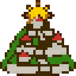 | Incas | Civilized: cities | 9 (the capital up to 13) | Jewelled Relics | Expert Farmer, Expert Silver Miner, Expert Ore Miner | the mountains and coast of western South America; up to 5 settlements |
| 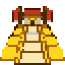 | Aztecs | Advanced: cities | 7 (the capital up to 10) | Gold Bars | Expert Farmer, Expert Fisherman, Master Sugar Planter | Mexico and Central America; up to 4 settlements |
| 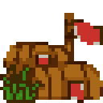 | Arawaks | Agrarian: villages | 5 (the capital up to 7) | Bone Jewelry | Expert Fisherman, Expert Farmer, Master Sugar Planter | the Caribbean islands and the shores around them; up to 5 settlements |
|  | Iroquois | Agrarian: villages | 5 (the capital up to 7) | Wood Carvings | Expert Farmer, Expert Ore Miner, Expert Fur Trapper | the north-east, from the Great Lakes to the Atlantic; up to 11 settlements |
|  | Cherokee | Agrarian: villages | 5 (the capital up to 7) | Turquoise | Expert Farmer, Expert Fisherman, Master Cotton Planter | the south-east of North America; up to 4 settlements |
| 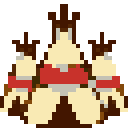 | Apache | Semi-Nomadic: camps | 3 (the capital up to 4) | Beads | Expert Fur Trapper, Expert Farmer, Seasoned Scout | the dry south-west of North America; up to 7 settlements |
|  | Sioux | Semi-Nomadic: camps | 3 (the capital up to 4) | Beads | Expert Farmer, Master Cotton Planter, Expert Fur Trapper | the northern plains; up to 7 settlements |
|  | Tupi | Semi-Nomadic: camps | 3 (the capital up to 4) | Gems | Master Sugar Planter, Expert Fur Trapper, Expert Farmer | the Amazon basin and the east of South America; up to 15 settlements |

<!-- /table -->

"Most often teach" is what their settlements usually teach on the America map. The trade a settlement
teaches is not fixed by its people: it follows from the land around it (see
[[Native Peoples#Learning from them]]). On a random map the peoples are scattered differently, but
the Incas and Aztecs are always kept to the west.

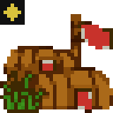 Each people has one capital, the first settlement founded. It starts the same size as the others but
can grow larger, it is shown with a gold star at its top left corner, and it counts for more in almost
everything: it alarms more easily, pays more for goods, yields more treasure, and can teach again and
again where an ordinary settlement teaches once.

Once you have met a people, a small mark at the top
right of each of their settlements shows how they feel about you. Its colour is their attitude:

<!-- table: native-attitudes -->

| Attitude | Mark | When | What it means |
| :--- | :--- | :--- | :--- |
| Content | green | tribal alarm under 25 | Friendly. Their braves call on your colonies with gifts and converts, and they teach and trade freely. |
| Uneasy | bright blue | tribal alarm 25 to 49 | Wary. Lessons may fail, a chief may have a scout killed, and a brave at your gate may demand goods instead of bringing them. |
| Restless | yellow | tribal alarm 50 to 74 | Sullen. They will not teach, a demand for tribute that fails is refused or laughed at, and their braves come to your colonies with black looks only. |
| Angry | orange | tribal alarm 75 or more | Hostile. Ships are turned away, wagon trains risk their cargo, scouts are killed, and braves attack your units and colonies. |
| War | red | this settlement's own alarm 128 or more | This settlement alone has turned on you: ships are turned away and its brave attacks your units and colonies. |

<!-- /table -->

The [[Reports and Advisers]] page describes the Indian Adviser's report (F9), which lists every people
you have met, whether you are at peace, their mood and your missions among them.

## First contact and the treaty

You meet a people when one of your units or colonies first stands beside one of their settlements, or
when one of their braves walks up to yours. Their alarm at you starts low, and is cut to 20 at most on
meeting. Their chief then offers a treaty of peace.

Accept it. The treaty gives you no land, but without it your missionaries cannot found missions, your
colonists cannot live among them and your soldiers cannot demand tribute. Refusing raises their alarm
by 100, to the top; the rise is halved for France, and halved again with Pocahontas. A treaty you leave unanswered counts as accepted at the end of your turn.

## Entering a settlement

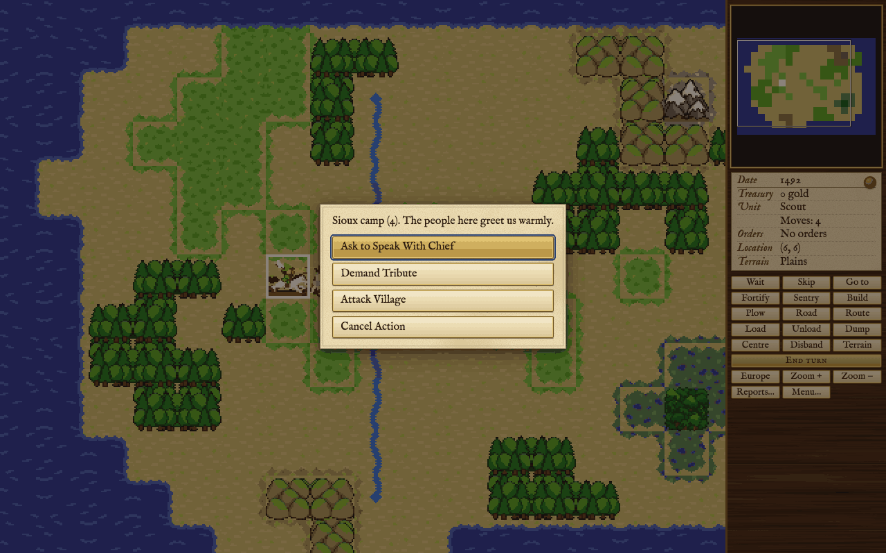

Move a unit into a settlement to visit it. A menu says how the people greet you (warmly, warily, sullenly
or with open hostility) and lists what this unit may do. A visit ends the unit's moves for the turn.

| Unit | What it may do |
| :--- | :--- |
|  Scout | **Ask to speak with the chief.** If the chief is pleased, one of three things follows, once per settlement: your scout is made a seasoned scout, the chief tells tales that show you the country six squares around, or he gives you gold, more from the richer peoples. He also names the goods his people want. If his people are wary, the scout may be killed instead; from Angry he always is. The Arawaks are quicker to kill than others. A seasoned scout is safer. |
| 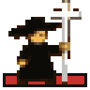 Missionary | **Establish a mission** where there is none, **denounce heresy** to take over another power's mission, or **incite** the people against another power for gold. Only under the treaty. |
| 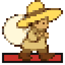 Colonist or pioneer | **Live among the natives** to learn their trade. Only under the treaty. |
|  Soldier, dragoon, scout | **Demand tribute**, under the treaty, or **attack the village**. Any land unit that can fight may attack. |
|  Wagon train or ship | **Trade**: sell your cargo, give it as a gift, and buy what they offer. |

A ship is turned away from a people who have never met you on land, from a people who are Angry, and
from a settlement whose own alarm is high. A wagon train that comes to an Angry people can only
**enter a hostile village**, which risks losing the wagon train and everything aboard.

**Tribute.** Demanding tribute weighs your whole strength in arms against theirs and their anger, with
some luck on both sides. If you win and have a colony, a settlement pays once: the good it has most of,
10 to 100 units, goes to your nearest colony. Otherwise they plead poverty, refuse (from Restless) or
laugh at you (always when they are Angry, or when you are the weaker). Paying angers them, twice as
much as a refusal or a laugh; pleading poverty costs nothing. Spain, and Hernan Cortes, make a demand
more likely to succeed.

## What makes them angry, and what calms them

A people's feeling toward you is two numbers. Tribal alarm, from 0 to 100, is how the whole people feels
and sets the attitude in the table above. Each settlement also has its own alarm, which rises and falls
with what happens near it: at its upper marks the settlement turns ships away and then turns on you on
its own.

**What raises alarm**

- **Your colonies near them.** Every turn each settlement looks at your colonies within six squares and
  takes alarm from the most pressing one. Large colonies press harder (colonists beyond the sixth count
  double), so do colonies with many buildings, and so does a nearer colony. A rival's mission in the
  settlement makes your colony press half again as hard; your own mission eases it.
- **Your soldiers near them.** Armed land units on the squares around a settlement add to the pressure,
  half as much inside a colony or a square further out.
- **Missions.** Each new mission among one people adds to their alarm against the welcome it brings, so
  the first is welcome and later ones less so.
- **Taking their land** without paying, and working it unpaid: see [[Native Peoples#Their land]].
- **Attacking them.** Attacking a brave raises tribal alarm, attacking a settlement twice as much, and
  attacking a capital six times as much, whoever wins. The settlement attacked turns on you at once.
- Refusing their demands, failing at haggling, demanding tribute and refusing the treaty.

**What lowers alarm**

- **Gifts.** A gift of goods lowers tribal alarm and the settlement's own; a full hundred wipes the
  settlement's alarm clean. Giving food to a hungry brave, or goods to one who demands them, calms them too.
- **Trade.** A sale they are keen on lowers alarm a little; so does buying from them.
- **Missions.** Your mission calms its settlement every turn, four times as much for a Jesuit mission.
- **Time.** Alarm cools a little each turn, faster the angrier they are. It no longer cools once you have
  declared independence.
- **Pocahontas.** When she joins your Congress every grievance against you is forgotten, and from then
  on alarm rises half as fast. 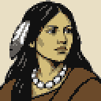

**The French advantage.** Every rise in alarm against France is halved, a new French mission angers
its people half as much, and inciting a people costs France two thirds of the price. With Pocahontas
too, a rise is halved twice.

**What happens at each attitude.** A brave who calls on your colony while his people are Content or
Uneasy may bring a gift, food for a hungry colony, or a convert from your mission; he may also beg for
food or demand a good. Handing it over calms them; refusing angers his settlement badly. From Restless
he comes with black looks only. A settlement that has turned on you, or a people who are Angry, sends
its braves against your units and colonies. A brave who beats a colony's defender raids it: he carries
off goods or gold, or burns a building, and a stockade and its successors protect against the worst
of it. A colony of one colonist with nobody under arms is burned to the ground. At full alarm a people
may burn all your missions among them. Peace returns of itself when their alarm falls back below
Angry.

After you declare independence, a people who hold a grudge against you, or are Uneasy or worse, may
side with the Crown.

## Trade

A wagon train or ship carries goods to a settlement. Each settlement wants some goods more than
others: what it lacks from the land around it, what its people have no way to make (trade goods, cloth,
rum, cigars, tools) and, until they have them, muskets and horses. A chief tells your scout which three
goods his people want most.

- **Selling.** They offer a price for one hold of up to 100 units, higher the more they want the good
  and the better they feel about you. You may accept, **haggle** for more, which can succeed several
  times while they are keen but ends the talks if it fails, or make it a **gift**.
- **What they will not take.** They will not look at the good they last bought, the one they last
  sold you, or one a haggle failed over. Selling them the same good again and again lowers its price;
  their memory of it fades with time.
- **Arms and mounts.** Muskets and horses arm and mount their braves. Selling 25 or more muskets or
  horses gives them one lot, 50 or more two; a gift of any amount gives them one. Horses also add to
  the herds they breed from.
- **Buying.** After a sale or a gift they offer three of the goods they have most of, never trade goods,
  tools or muskets; where food would be among them they offer coats instead. You are offered as much as you just sold or gave, a quarter of it on a ship. Their price
  follows the European price for made goods, falls when they have plenty and rises with their alarm.
  You may haggle a quarter off; if it fails they sell nothing more until your next sale or gift.

The goods a settlement has to spare and wants are worked out from the land around it each time you ask,
so a settlement whose land you farm changes what it wants. See [[Europe and Trade]] for the European
market.

## Missions and converts

A missionary founds a mission in a settlement that has none. It always succeeds and uses up the
missionary. A Jesuit missionary, or any missionary once Jean de Brebeuf is in your Congress, founds a
Jesuit mission, which works four times as hard.

A mission earns goodwill and calms its settlement every turn (twice as much at a capital or with
Bartolome de las Casas, half as much with Juan de Sepulveda). It also brings converts: when a brave from
that settlement pays a friendly call on one of your colonies, he may bring a convert with him, more
often from the advanced peoples and twice as often from a Jesuit mission. Defeating a settlement that
holds your mission can also bring a convert, more often for Spain and with Sepulveda, less with las
Casas.

A missionary may **denounce heresy** in a settlement with another power's mission. If he wins, the mission
becomes yours and the people think better of you; if he loses, worse. He is removed either way.
A missionary may also **incite** a people against another power they have met. The price depends on
their strength and how they feel about you, less for each of your missions among them; paying sets
them hard against the target.

**Converts.** A convert is one of the native people
who has come to live among you. On the land and the sea he is better than a colonist: he makes one more
food, sugar, tobacco, cotton, furs or fish on any square where he makes some. Indoors he makes little,
he cannot be schooled or taught a native trade, and he cannot found a colony. A convert left outside a
colony goes home after eight turns. When Bartolome de las Casas joins your Congress every convert you
have becomes a free colonist.

## Learning from them

A free colonist or indentured servant who lives among the natives learns their trade and becomes an
expert where he stands. The trades are farming, fishing, fur trapping, ore and silver mining, the three
planters, fur trading, weaving and scouting; what a settlement teaches follows from what its land
yields, camp peoples never teach ore mining or fur trading, and only the city peoples teach weaving or
silver mining.

- A petty criminal is refused, and an expert is told he already knows a trade. A convert cannot ask.
- A settlement teaches once; a capital teaches as often as you like.
- From Uneasy the lessons may fail, and you may try again. From Restless they refuse, and asking angers them.

The [[Units]] page lists every expert and what it is worth.

## Their land

Each settlement owns the land within its reach: the squares beside it for camp and village peoples, two
squares for the Aztecs and three for the Incas. You are asked about native land when you put a colonist
to work on it, or when a pioneer clears a forest or builds a road on it. Founding a colony and plowing
open land are never questioned.

You may then give up, **pay** for the square, or **go ahead** and take it. The price is higher for the
more advanced peoples, nearer the settlement, at a capital, on a square with a special resource, the
more land they have sold already and the angrier they are; a small power with few colonists pays less.
Taking it, or working it unpaid, raises their alarm, most beside the settlement. Once Peter Minuit is in
your Congress, the natives no longer ask payment for their land.
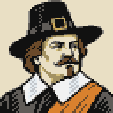

## Burning their villages

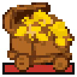 A soldier, dragoon or artillery that attacks a
settlement fights a band of its braves, armed if the people have muskets and mounted if they have
horses. Each win takes one of its people; when the last is gone the settlement is destroyed.

**What you gain.** The settlement's land is free. Its treasure may appear on the ruins as a treasure
train: a camp yields 200 to 400 gold one time in seven (one in four for Spain), a village 300 to 800
gold one time in three, and a capital always, doubled. Aztec cities always yield thousands, and Inca
cities more. Hernan Cortes makes every settlement yield, and more. If the settlement held your mission,
a convert may follow.

**What you lose.** The people's alarm soars at every attack, and they hold a grudge that can send them
to the Crown's side after you declare independence. Every settlement you destroy costs you score (see
[[Score and Hall of Fame]]). Destroying a capital breaks a people's spirit: their alarm falls and every
settlement is calmed. When a people's last settlement is destroyed they are gone from the game for
good. See [[Combat]] for how a fight is decided.

## Their braves

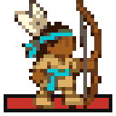 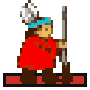
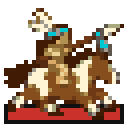 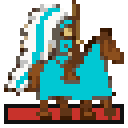
Each settlement keeps one brave abroad. Braves wander near home, camp peoples a little further, and
call on colonies nearby. At home a brave takes up muskets if his people have any and horses if their
herds are large enough, so the arms you sell them come back to face you.

## Founding Fathers who deal with the natives

- **Pocahontas**: all native alarm against you is forgotten, and rises half as fast.
- **Peter Minuit**: native land is free.
- **Jean de Brebeuf**: every mission works as a Jesuit mission.
- **Juan de Sepulveda**: defeated settlements more often send converts.
- **Bartolome de las Casas**: every convert becomes a free colonist.
- **Hernan Cortes**: conquered settlements always yield treasure, and more of it.
- **Francisco Coronado**: no scout is killed for speaking with a chief; one who would have been comes away with nothing.

See [[Founding Fathers]] for when each one can join.
