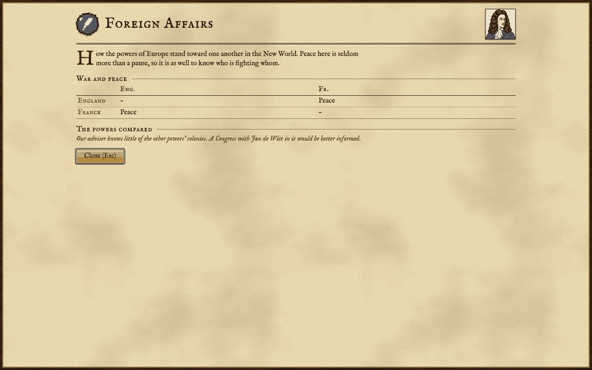

The other European powers: meeting them, war and peace, and the Foreign Affairs report.

## The four powers

Four European powers race for the New World: England, France, Spain and the Netherlands. You lead one of them, chosen when the game begins (see [[Getting Started]]); the other three are played by the computer. Each power has one strength of its own, such as England's faster immigration or Spain's edge against native settlements, and it applies to the computer powers just as it does to you.

The computer powers play the same game you do. They move, found colonies, build and fight through the same actions and by the same rules for those, and each starts, as you do, with a ship and a small landing party. In money matters they have a few allowances of their own: the Crown does not tax their sales in Europe, for one. You will see them found colonies along the coast and inland, put colonists to work in fields and workshops, sail cargo to Europe to sell and come back with goods and recruits, buy ships, train and arm soldiers to guard their colonies, send missionaries to the native peoples, and fight natives and Europeans when it suits them. Their own colonists grow restless for liberty too: a computer power whose rebels grow strong enough is granted its independence and plays on as a free nation.

## Meeting them

You meet another power when one of your units or colonies stands beside one of theirs on land. From then on you have contact, and with contact comes the question of war or peace: two powers in contact without a treaty are at war.

Soon after you meet, the other power asks for an audience. The talk is a short series of questions:

- If your privateers have been attacking their ships, they ask you to call them off.
- If your troops stand at the gates of their colonies, they ask you to pull them back.
- If they are strong enough and in a hard mood, they demand tribute in gold. Pay, or refuse and risk war.
- If there is no treaty between you, they propose one. Turning it down leaves you at war; a power that fears you may offer gold to make peace.

Once a treaty is in force, an audience lets you say your piece in turn: go in peace; ask them to pull their forces back from your colonies (for a price, or by threatening them); ask what their lives are worth to them, which a frightened power answers with gold; or pay them to join you against a third power or a native people they have met. A talk that ends in peace binds the computer power to keep it for some turns.

The same power asks for an audience only every so often, but you can ask for one yourself: move a scout next to one of their colonies and choose **Meet with the mayor**. A scout can also **Infiltrate the colony** to look around inside it, and may be seized as a spy for his trouble.

## War and peace

Between two powers there is no contact, war, or peace. Attacking a unit or colony of a power you have a treaty with breaks the treaty, and the game asks you first; the victim remembers it. Privateers fly no flag, so their attacks do not openly break a treaty, but the victim notes the piracy and may come to bear a grudge.

At war, a computer power goes after colonies big enough to be worth the trouble on the land where it has a footing, and will carry troops by ship to land them on a beach near a colony it covets. Your colonies are its favourite target when they are the only European ones on a landmass. It also defends its own colonies, keeping a garrison in each. On the easier levels it does not march on a colony of yours it has never seen, for much or all of the game.

The computer powers decide war and peace among themselves as well, and you may find them at war with each other. Your own King may also drag you into his quarrels: from time to time the Crown declares war on a rival you are at peace with and sends gold and soldiers to help. For a time after that the rival will not be talked out of it.

## Trading in their colonies

With a treaty in force and **Jan de Witt** in your Congress (see [[Founding Fathers]]), a ship or wagon train can trade with a foreign colony: move it into the colony and choose a cargo to sell. The colony buys up to a hundred of it, as much as its warehouse has room for, at three quarters of what its own home market would pay and no more than its treasury holds. It is a way to sell without sailing to Europe, and without the Crown's tax.

## The Foreign Affairs report

Press F8 for the Foreign Affairs report. It always shows a table of war and peace between the powers still in the New World; a power that has won its independence is marked.

Without Jan de Witt that is all your adviser knows. With him in the Congress the report also compares the powers: their colonies, population, average colony size, military power (the attack of their armed land units), naval power (the attack of their ships) and merchant marine (the cargo holds they have afloat). Once you have declared independence the adviser has nothing more to report.

## Benjamin Franklin

**Benjamin Franklin** is the Founding Father for dealing with the other powers. With him, the King's wars in Europe no longer reach your colonies, so the Crown cannot drag you into a war with a rival you are at peace with. Rival powers also ask less of you in audiences: their demands are halved, they will not take a hard line with you, and the price of pulling their troops back from your colonies is halved.

## When you declare independence

The other powers do not stay to watch your war with the Crown. When you declare independence the smaller of the remaining powers becomes the friend who may later come to your aid, the larger may offer soldiers for hire, and every other power leaves the New World: its units vanish, though its colonies remain on the map. See [[The Crown and Independence]].

Before that, in a game with one human player, the first time your colonies' rebel sentiment reaches half, the smallest computer power is absorbed by the next smallest: its colonies and units change flag, and it plays no more.
