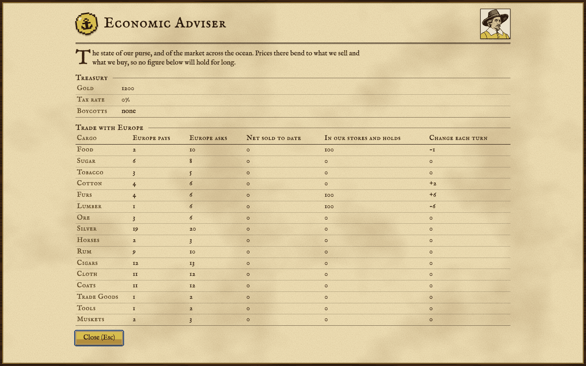
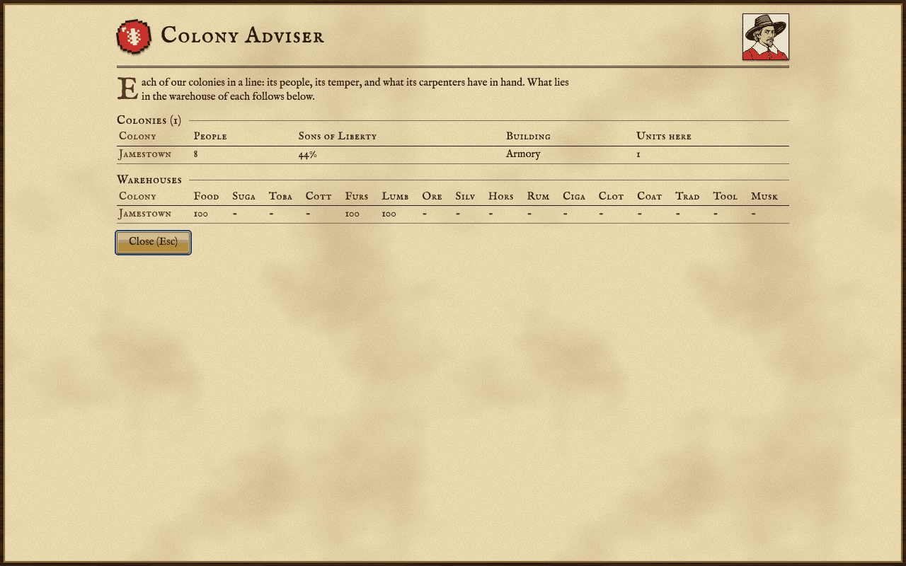
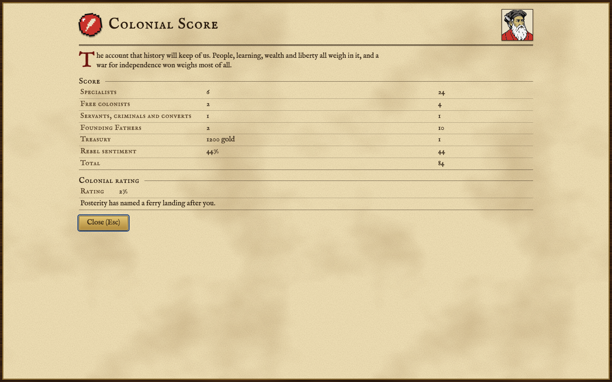

The reports you open with F1 to F10, and the advisers who give them.

## Opening a report

Your advisers keep ten reports on the state of your colonies. Press F1 to F10 on the map, or click **Reports...** under the map and pick one. Each report is written fresh from the game as it stands when you open it, on a sheet of parchment headed by its adviser's seal and portrait. Press Esc or Enter, or click **Close**, to put it away.

Where a row of a report is about a place, such as a colony, a ship or a native settlement, you can click it (or move to it and press Enter) to close the report and show that place on the map.

Four advisers sign the reports. The Continental Congress, Foreign Affairs and the Colonial Score each have their own; the other seven reports come from your council of advisers.

| Adviser | Reports |
| :--- | :--- |
|  | F1, F2, F4, F5, F6, F7, F9 |
|  | F3 |
|  | F8 |
|  | F10 and the Hall of Fame |

## The ten reports

### F1 Terrain Information

 What each kind of land is worth: for every terrain, the movement it costs, the defence bonus it gives and the base figure of each good it yields. Use it to compare one kind of land with another when choosing where to found a colony or what to put a colonist to work on. The figures are the terrain's own, before anything is added: a colonist working the square brings in one more food than shown and twice the lumber, and experts, plowing, rivers, roads and special resources add more; see [[The Map]].

### F2 Religious Adviser

 How close the next immigrant is: the crosses you have against the number needed, how many your colonies make each turn and about how many turns that leaves; who is waiting on the docks in Europe to come over; and the missions you keep among the native peoples. Use it to judge whether a church or a preacher would pay.

### F3 Continental Congress

 The Founding Fathers seated in your Congress and what each does; the candidate you are working toward and the bells he still needs; your rebel sentiment against the Tories; and the force the Crown holds ready to send against a rebellion. See [[Founding Fathers]] and [[The Crown and Independence]].

### F4 Labor Adviser

 Your colonists counted by occupation, with how many of each are in which colony and how many are outside the colonies. Use it to find the expert you need, or to see that you have more of one trade than your buildings can use.

### F5 Economic Adviser

 Your treasury, the Crown's tax rate and any boycotts; then, for every cargo, what Europe pays for it and asks for it, how much you have sold there to date (net of what you bought), how much lies in your colonies' stores and your holds, and how much more or less of it your colonies have each turn. Use it to decide what to make and what to sell; see [[Europe and Trade]].

### F6 Colony Adviser

 Every colony at a glance: its people, its Sons of Liberty membership, what it is building and how many units stand in it; and below, what lies in each colony's warehouse. Use it to spot a colony that has stalled or is about to run out of room; see [[Colonies]].

### F7 Naval Adviser

 Every ship you own: where she is (in port, at sea, in Europe or on the way), where she is bound or which trade route she follows, whether she is under repair, and what she carries, goods and passengers.

### F8 Foreign Affairs

 Which powers are at war and which at peace, and, with Jan de Witt in your Congress, how the powers compare in colonies, people and arms. It is closed to you once you have declared independence. See [[Other Powers]].

### F9 Indian Adviser

 Every native people you have met: peace or war with you, their mood toward you (content, restless, angry or hostile), how many of their settlements you know, how many of your missions stand among them, and a warning when one of their settlements is close to violence. See [[Native Peoples]].

### F10 Colonial Score

 Your score as it would stand if the game ended now, term by term, with the Colonial Rating and what posterity would name after you. The same report closes every game, with the Hall of Fame beneath it. See [[Score and Hall of Fame]].

## Colony report options

Press Alt+O for the colony report options. They decide what the colony screen labels and which news from your colonies reaches the log, so that a large empire does not bury you in messages:

- **Labels on buildings**: name each building on the colony screen.
- **Labels on cargo and terrain**: name each cargo and what each square yields.
- **Report when colonists are trained**.
- **Report food shortages**.
- **Report raw materials shortages**.
- **Report tools needed for production**.
- **Report inefficient government**: when Tories in a colony hold back its production.
- **Report new cargos available**: a full load ready to ship, or a warehouse overflowing.
- **Report Sons of Liberty membership**.
- **Report rebel majorities**.

All are on to begin with. Starvation, a finished building and a finished unit are always reported. Like the game options (see [[Help and Options]]), these are kept in your browser and apply to every game.
