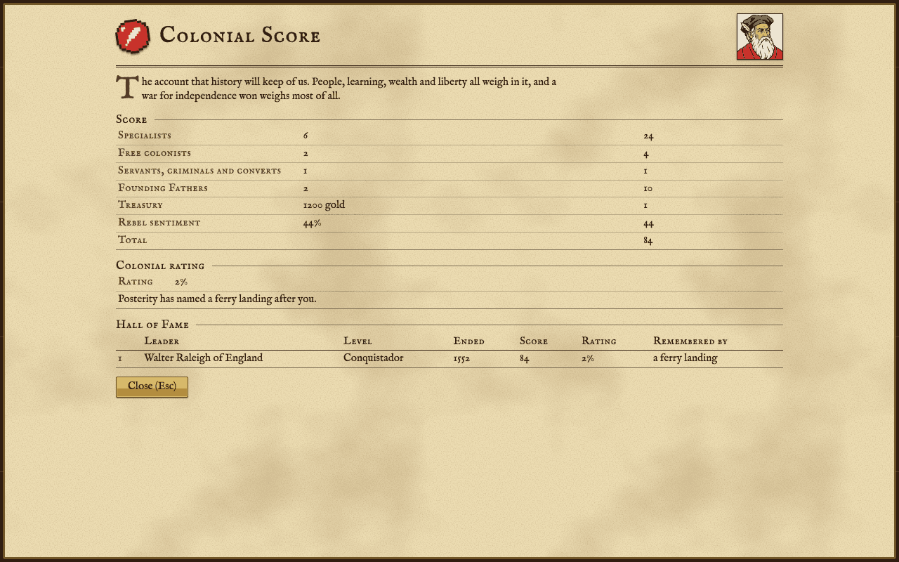
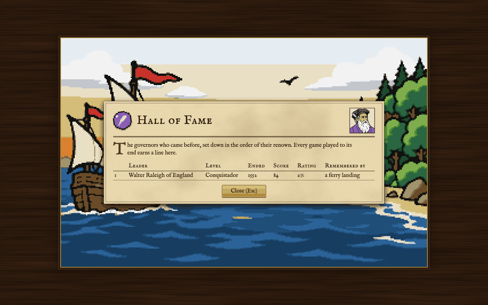

How a game is scored, how it ends, and the Hall of Fame.

## The score

Your score measures the colonies you leave behind: how many people live in them and how skilled they are, the Founding Fathers in your Congress, the gold in your treasury and how strongly your people want their liberty. A war of independence won counts for most of all. Press F10 at any time to see the score as it stands, term by term.

<!-- table: score -->

| What counts | Points |
| :--- | :--- |
| Each specialist (a colonist with a skill), in a colony or outside one | 4 |
| Each free colonist | 2 |
| Each indentured servant, petty criminal or Indian convert | 1 |
| Each Founding Father in the Congress | 5 |
| Gold in the treasury | 1 for every 1000 |
| Rebel sentiment (as it stood at the Declaration, once that is made) | 1 per percentage point |
| Each native settlement you destroyed | minus 1 (Discoverer) to minus 5 (Viceroy) |
| Independence declared before 1780, and won | 2 for each year early |
| Liberty bells rung after a foreign power intervened in your war of independence | 1 per 100 bells, at most 100 |
| Independence won: the whole is multiplied | x2 if no other power was independent first; x1.5 behind 1 power; x1.25 behind 2 powers; x1.125 behind 3 powers |

<!-- /table -->

Colonists count wherever they are, in a colony or out on the map, as soldiers, pioneers or scouts. During the war of independence, colonies the King has taken from you still count as yours. Rebel sentiment is the share of your people who back independence; once you have declared, the figure is fixed at what it was on that day.

## The Colonial Rating

The score is counted the same way on every level of difficulty, apart from the price of a destroyed native settlement; the rating is not. The score is multiplied by the level's rating factor and divided by a hundred to give the **weighted score**, and your **Colonial Rating** is half the weighted score, as a percentage. So the same colonies rate two and a half times higher on the hardest level than on the easiest.

<!-- table: score-rating -->

| Level | Rating factor (per hundred) | A score of 100 gives a weighted score of | and a Colonial Rating of |
| :--- | :--- | :--- | :--- |
| Discoverer | 4 | 4 | 2% |
| Explorer | 5 | 5 | 2% |
| Conquistador | 6 | 6 | 3% |
| Governor | 8 | 8 | 4% |
| Viceroy | 10 | 10 | 5% |

<!-- /table -->

The weighted score also decides what posterity names after you. There are twenty-four honours, from the humblest to the grandest; each needs a weighted score above a mark that rises faster the higher you go:

<!-- table: honours -->

| Rank | Weighted score of at least | Colonial Rating of at least | Posterity names after you |
| :--- | :--- | :--- | :--- |
| 1 | 1 | 0% | a goat track |
| 2 | 2 | 1% | a village pump |
| 3 | 4 | 2% | a ferry landing |
| 4 | 6 | 3% | a tavern |
| 5 | 9 | 4% | a mill pond |
| 6 | 13 | 6% | a market square |
| 7 | 17 | 8% | a lighthouse |
| 8 | 22 | 11% | a parish |
| 9 | 28 | 14% | a ridge |
| 10 | 34 | 17% | a harbor |
| 11 | 41 | 20% | a schoolhouse |
| 12 | 49 | 24% | a bridge |
| 13 | 57 | 28% | a street |
| 14 | 66 | 33% | a township |
| 15 | 76 | 38% | a river |
| 16 | 86 | 43% | a fort |
| 17 | 97 | 48% | a county |
| 18 | 109 | 54% | a university |
| 19 | 121 | 60% | a mountain |
| 20 | 134 | 67% | a city |
| 21 | 148 | 74% | a state |
| 22 | 162 | 81% | a capital city |
| 23 | 177 | 88% | a sea |
| 24 | 193 | 96% | a continent |

<!-- /table -->

## When the game ends

The game is scored once, when it ends. It ends:

- in **1800**, if you have not declared independence by then: your term as Viceroy is over;
- in **1850**, if you have declared but the war is still being fought: the Congress makes its peace with the Crown and the rebellion is lost;
- when you **win** the war of independence, or **lose** it (see [[The Crown and Independence]]);
- from 1600 on, at the start of any turn in which you hold no colony in the New World: the Crown withdraws your charter;
- when you **retire**.

To retire, press **Shift-R**. The game asks first; if you say yes, it is scored as it stands and ends. A game ended by retiring cannot be played on.

When the game ends in 1800 or 1850, you may play on after the scoring. The calendar will not stop the game a second time. If it later ends another way (you retire, or a war of independence is won or lost), it is scored again as it then stands, and that score goes to the Hall of Fame as well.

## The Hall of Fame

Every finished game is put forward for the Hall of Fame: your leader and nation (marked a rebel if you declared independence and a liberator if you won it), the level, the date the game ended, the score, the rating and the honour. Only the ten best are kept, best rating first and then best score, so a game that rates below all ten leaves no line. The same ending is entered only once, even if you load the game again after it has ended.

The Hall of Fame is shown beneath the score when a game ends, and from the title screen with **View Hall of Fame**.

The Hall of Fame is kept in your browser, like your saved games. It does not travel with you to another browser or computer, and clearing the site's data for the game clears it too.
