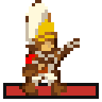
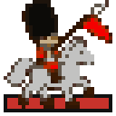
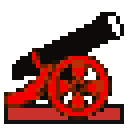
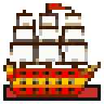

Your colonies belong to the Crown, and for most of the game the Crown is a distant partner: it sells you goods, sends you colonists, taxes your trade and now and then drags you into its wars. All the while it builds an army to hold you. The game ends in earnest when you declare independence and that army comes. This page tells what the Crown does over a game, how to bring your people to the point of rebellion, what the Declaration sets off, and how the war is won or lost.

## What the Crown does over a game

### Taxes

The Crown takes a share of every sale you make in Europe or through a Custom House, and raises it from time to time. Each rise can be refused by holding a party in a port colony, at the cost of a boycott on one good. The whole story is in [[Europe and Trade]] under Taxes. Every gold piece of tax you pay goes into the royal purse, which pays for the army below.

### The Royal Expeditionary Force

   

From the first turn the King keeps an army ready to put down a rebellion: regulars, cavalry, artillery and the men-of-war to carry them. Its size at the start depends on the level you play.

<!-- table: expeditionary-force -->

| Level | Regulars | Cavalry | Artillery | Men-of-War | Royal purse each turn (before 1600) | Bells for foreign intervention |
| :--- | :--- | :--- | :--- | :--- | :--- | :--- |
| Discoverer | 15 | 5 | 2 | 2 | 10 | 2000 |
| Explorer | 23 | 10 | 8 | 5 | 18 | 3500 |
| Conquistador | 31 | 15 | 14 | 8 | 26 | 5000 |
| Governor | 39 | 20 | 20 | 11 | 34 | 6500 |
| Viceroy | 47 | 25 | 26 | 14 | 42 | 8000 |

<!-- /table -->

The force grows all game. The royal purse fills with every tax you pay and with a sum of its own each turn, which doubles from 1600, again from 1700 and again from 1750. Each time the purse reaches 1800 gold, the King adds a unit: mostly regulars, with cavalry, artillery and ships added to keep the army in proportion. You are told each time ("The Crown has added ... to its Expeditionary Force"). The army stops growing on the day you declare.

**Reading its size.** The Continental Congress report (**F3**, see [[Reports and Advisers]]) lists the force as it stands: regulars, cavalry, artillery and men-of-war. Check it before you declare. High taxes paid over many years make a large army, so a colony that trades heavily in Europe also arms the King against itself.

### Wars in Europe

Now and then the Crown goes to war in Europe and orders you to fight one of the other powers in the New World. You hear "The Crown is at war in Europe and sends ... gold and ... veteran soldiers to the docks", and that power declares war on you. The aid is larger when the enemy is stronger than you. For sixteen turns the war is the King's affair: your enemy presses harder and will not talk peace. These wars come more often late in the game and on the harder levels, only while you are at war with no one, and never once Benjamin Franklin sits in your Congress.

### The frigate offer

If foreign frigates prowl near your colonies (one within five squares of a colony, or warships near more than three of them) and you have no frigate of your own, the Crown may offer one. The question comes on every eighth turn. The price is ten more points of tax. Accept and the frigate sails to you from Europe, and the rise comes like any other tax rise, so you may still answer it with a party.

### Mercenaries

About one turn in twenty-one, a Crown (your own, or one at peace with you) offers a band of veteran dragoons, sometimes with artillery, for a price in gold. The offer comes only when your treasury can pay it, and it is all or nothing. Accept and the band musters in your most populous colony.

### Treasure

When you carry a treasure home in the King's ships, he keeps a share for the trouble: the larger of twice the tax rate and a fixed share that grows with the level, never more than nine tenths. With Hernan Cortes he keeps only the tax rate. After the Declaration a treasure is yours whole. Treasure trains are described in [[Units]].

### The War of Succession

The first time your rebel sentiment reaches 50% (or when you declare, if that comes first), a war of succession is settled in Europe: the smallest of the other powers is absorbed by the next smallest. Its colonies and units in the New World change hands; what it had at sea or in Europe is lost, and it takes no more turns. You read "The War of Succession is over in Europe; one power has ceded its colonies to another."

### Rivals win their independence

The other powers have colonists of their own who grow restless. A computer power whose rebels grow numerous enough is granted its independence and plays on. You hear of it when one comes close, and when it happens ("A rival power has been granted its independence"). It matters to you because declaring and winning before any rival does is worth the most at the end (see [[Score and Hall of Fame]]).

## Rebel sentiment

Before you can declare, half your people must be with you. **Rebel sentiment** is the share of your colonists who belong to the Sons of Liberty, taken across all your colonies and weighted by each colony's population. The Continental Congress report (**F3**) shows it as Sons of Liberty against Tories.

Sentiment rises with **liberty bells**:

- Statesmen in a Town Hall ring bells; an Elder Statesman rings twice as many. A Printing Press adds half again, or a Newspaper doubles them instead. See [[Colonies]] and [[Buildings]].
- Thomas Jefferson, Thomas Paine and Simon Bolivar each add to bells or membership directly; see [[Founding Fathers]]. The same bells also bring Founding Fathers into your Congress.
- A tax party raises membership in the colony that holds it.

Membership moves slowly: a colony drifts toward what its bells can sustain over many turns, and a growing colony needs more bells to keep the same share. Small colonies with a statesman or two rise fastest. Sons of Liberty membership also helps production long before the Declaration, so ringing bells pays all game.

## The Declaration of Independence

**What is needed.** Rebel sentiment of 50% or more. Nothing else. Press **Shift-I**, or choose *Declare independence* from the menu. The game asks first: "Declare independence from the Crown? There is no going back." If too few are with you, it tells you the figure.

**What happens at once.** Your turn ends, and:

- **The other powers leave.** The War of Succession is settled if it has not been. Of the two powers left, the smaller becomes your possible *friend*, who may come into the war on your side; the larger may hire out soldiers to you. Then every other power withdraws from the New World: its units vanish and it takes no more turns, though its colonies remain on the map.
- **Seizure.** Everything of yours in Europe, on the docks or on the ocean is seized: ships crossing, cargo in port, people waiting.
- **Trade stops.** Europe is closed: no screen, no purchases, no recruits, no sailing there. Unless Peter Stuyvesant has let you build Custom Houses, you have no trade with Europe at all; those you have go on selling, and no tax is taken. No new Founding Fathers join, and the King's army grows no more.
- **The Continental Army forms.** As your next turn opens, in each colony with Sons of Liberty membership of 50% or more, some of the veteran soldiers and dragoons standing in it become  Continental Army and  Continental Cavalry, without needing more muskets. The more of the colony is with you, the more of them change: at least one, never more than half the colony's population.
- **The bells' new purpose.** From now on, bells you ring count toward foreign intervention. The first time you ring any, you are told how many it will take and who your friend would be.

You can no longer found colonies, attack foreign colonies or deal with the other powers. The Foreign Affairs report closes.

## The War of Independence

### Landings

The King moves at the end of each of your turns. While he has troops left to send, a man-of-war carries a wave of three to six units to one of your ports. He picks the port he can most surely carry: a large colony full of Tories and thinly held draws him; muskets in store, strong defenders, a fort or a fortress put him off. The ship anchors beside the colony and the wave comes ashore on the squares between ship and colony. Any unit of yours standing on those squares, and any ship under the anchorage, is lost. You read "The Royal Expeditionary Force has landed ... units beside ...". When the army is nearly spent, the last small remainder is not sent.

### How the Crown's troops fight

Once ashore, the King's troops do not wait. A unit beside one of your colonies storms it. Otherwise it attacks one of your units in the open when its odds are even or better, and failing that it marches on your nearest colony. When it takes a colony it leaves one armed unit fortified there.

- **Attacking a colony**, the King's troops get a bombardment bonus of half again, plus a bonus equal to the colony's Tory share. A colony full of Tories is easy prey.
- **In the open**, the King's troops get a small bonus that grows with the level. When you attack them in the open, the terrain works for you as an ambush.
- **A colony that falls** yields no plunder, but a third of its Sons of Liberty membership is lost. In a colony the King holds, the bells it would ring work against liberty.
- **Your veterans** who win promotion in a fight after the Declaration join the Continental Army or Cavalry.

The units and their strengths are in [[Units]]; how a battle is decided is in [[Combat]].

### Defending and retaking colonies

Keep soldiers fortified in every port, with muskets in the warehouse and a stockade, fort or fortress. Raise Sons of Liberty membership in your ports before you declare: both because more veterans turn Continental there, and because the King's bonus against a colony is its Tory share. Keep strong units, cavalry and artillery a little inland to strike the King's troops in the open, where the terrain helps you. To **retake** a colony, attack it: rebels attacking a colony the King holds get a bonus equal to its rebel share (and, once your friend has come in, the bombardment bonus as well).

### Tory uprisings

When the King has nothing left to land, the Tories in your colonies may rise instead. Each turn there is a good chance of a rising at the colony where Tories are many and defenders few: Tory soldiers, some of them veterans or mounted, appear on the free land around it. Each colony rises at most once, and never where the King's men already stand at the gate.

### Foreign intervention

Your friend, the smaller of the powers that left, comes into the war once your colonies have rung enough liberty bells since the Declaration; the number for each level is in the last column of the table near the top of this page, and you are told it when you first ring bells. When it is reached, the friend declares war on the Crown, and from then on, at the start of your turns, a man-of-war arrives at one of your ports with up to six units put straight into the colony: Continental Army, with up to two Continental Cavalry and two artillery. The ship is yours to command. When the friend's ships are all sent, nothing more comes.

### Hiring Continentals

The larger of the powers that left will hire out trained troops. On any turn when no friendly ship is due, there is one chance in three of an offer: a few Continental Army with one Continental Cavalry or one piece of artillery, for a price per head that rises with the level. It is all or nothing, and only offered if your treasury can pay. Accepted, they join your largest colony at once. Gold saved before the Declaration buys these soldiers.

## How the war ends

**You win** when the King holds none of your colonies, his regulars, cavalry and artillery ashore are down to a remnant, and he has almost nothing left to send. The remnant he may keep is larger once you have beaten his troops in any fight. Tory militia and ships do not count.

**You lose** when you hold no port, or no colony, or the King holds nine tenths of the people living in colonies. You are warned each turn when you are down to fewer than three colonies or ports, or the King holds four fifths of the people.

**If the war is still going in 1850**, it ends in a negotiated peace, and that counts as a loss.

Either way the game is scored. Winning adds points for each year you declared before 1780, and for the bells rung after a friend came in, and the whole score is multiplied by how many rivals won their independence before you. See [[Score and Hall of Fame]].
