The map, its terrain, rivers, roads and resources, and how to read it.

## The screen

The map fills most of the screen. Your units, your colonies and everything you have seen of the New World are drawn on it, one square at a time. To the right is the sidebar:

- **The New World view** at the top: the whole map in miniature, with a white box lined in ink round the part the main map shows. Land and sea are in flat colours, what you have not seen yet is bare vellum. Click anywhere on it to centre the main map there.
- **The panel** below it: the date, your treasury, the active unit with its moves left and its orders, and the square it stands on: its position, its terrain, and its features (a river, a road, plowed land, a resource, a rumor, a colony or a settlement, or whose land it is).
- **The buttons**: every order, End Turn, Europe, the zoom buttons, the reports and the menu, so you can play without the keyboard (see [[Controls]]).
- At the foot, the units aboard a ship or sharing the square with the active unit.

### Zoom

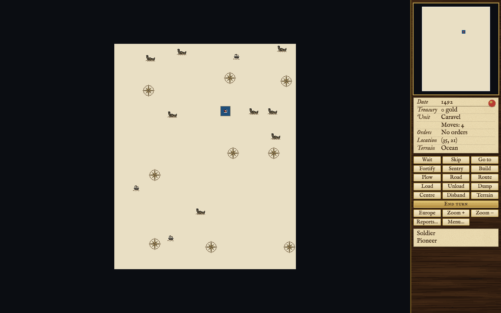

There are four zoom levels. Press Z to zoom in and X to zoom out, use the Zoom + and Zoom – buttons, or turn the mouse wheel (pinch on a trackpad) to zoom about the pointer.

- **Closest**, 15 squares across and 12 down: the detailed art, every unit and every mark on the ground. The game starts here.
- **Near**, 30 by 24: your colonies and their surroundings.
- **Far**, 60 by 48: a whole coast or a campaign.
- **Farthest**, 120 by 96: the whole map at once. Each terrain is one flat colour, and forest is always a different colour from the open ground under it.

The view follows the active unit. Drag the map, or rest the pointer at its edge, to look elsewhere; press C to centre on the active unit again.

### The unexplored chart

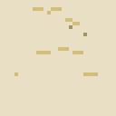  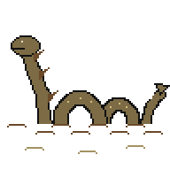 

What you have not yet seen is drawn as an explorer's chart: bare vellum, hatched in ink along every edge where it meets known ground, with compass roses, sea serpents and little ships scattered over it. The marks are decoration only. They stand where every square they cover is still unknown, and one goes as soon as any of its squares is seen. Where they stand is fixed by the map's seed, so the same map always draws the same chart. Beyond the edge of the map the screen is dark.

### What you can see

A unit sees the squares next to it. A scout, a galleon, a privateer and a frigate see two squares away, and one Founding Father lets every unit see one square farther. A square you have seen once stays on your map for the rest of the game. Other powers' units are different: you see them only while one of your own units is next to them.

Press H (or the Terrain button) to see the bare ground: forests and pieces are taken away until the next key, so you can read what lies under them.

### Moving the view without a unit

Press V for view mode. A cursor takes the place of the active unit: the arrow keys move the cursor, not the unit, and the sidebar describes the square under it. Press Enter on one of your colonies to open it. Press M, or click one of your units, to go back to moving units.

### The tooltip

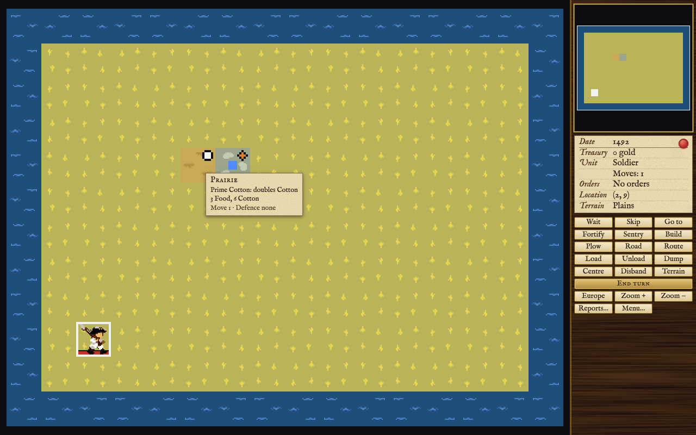

Rest the pointer on a square for a moment and a small slip describes it: the terrain's name; its resource and what that does; any river, road, plowing or rumor; what a free colonist would bring in working it; and its move cost and defence bonus. If the map shows a unit standing there, the slip names it under a rule: each of your own units on the square with its moves, its orders and what it carries; for another power, whose the piece is and its kind (and for a ship, how many of her holds are in use), with "and others" where more stand behind it. Units inside a colony are not listed. Move the pointer and the slip follows from square to square. Turn it off with the "Terrain tooltips" option (see [[Help and Options]]); it does not appear on a touch screen, over an unexplored square, or while a dialog is open. Right-click a square to open the encyclopedia at its terrain, or at the unit standing on it.

## Terrain

Every square is one kind of terrain. Each open kind of ground has a forested twin: clearing the forest leaves the open ground, and a colonist working the two gets different goods. Hills and mountains stand on their own: they are slow to cross and good to defend, they are rich in ore, and they cannot be plowed. Arctic ice lies along the top and bottom of the map and gives nothing at all.

The table gives what a free colonist (no expert, no bonuses) gets from a bare square: no river, road, plowing or resource. The move cost is in moves; the defence bonus is added to a unit defending there. A colony on a square works it differently: see [[The Map#The colony square]].

<!-- table: terrain -->

|  | Terrain | Kind | Move cost | Defence | A free colonist gets | Cleared, it becomes |
| :--- | :--- | :--- | :--- | :--- | :--- | :--- |
| 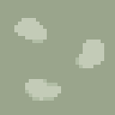 | Tundra | open | 1 | none | 3 Food, 2 Ore |  |
| 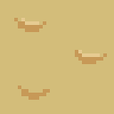 | Desert | open | 1 | none | 2 Food, 1 Cotton, 2 Ore |  |
|  | Plains | open | 1 | none | 5 Food, 2 Cotton, 1 Ore |  |
| 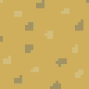 | Prairie | open | 1 | none | 3 Food, 3 Cotton |  |
| 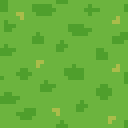 | Grassland | open | 1 | none | 3 Food, 3 Tobacco |  |
|  | Savannah | open | 1 | none | 4 Food, 3 Sugar |  |
|  | Marsh | open | 2 | +25% | 3 Food, 2 Tobacco, 2 Ore |  |
|  | Swamp | open | 2 | +25% | 3 Food, 2 Sugar, 2 Ore |  |
| 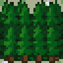 | Boreal Forest | forested | 2 | +50% | 2 Food, 3 Furs, 4 Lumber, 1 Ore | Tundra |
| 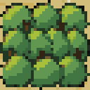 | Scrub Forest | forested | 1 | +50% | 2 Food, 1 Cotton, 2 Furs, 2 Lumber, 1 Ore | Desert |
| 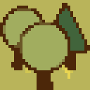 | Mixed Forest | forested | 2 | +50% | 3 Food, 1 Cotton, 3 Furs, 6 Lumber | Plains |
| 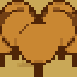 | Broadleaf Forest | forested | 2 | +50% | 2 Food, 1 Cotton, 2 Furs, 4 Lumber | Prairie |
|  | Conifer Forest | forested | 2 | +50% | 2 Food, 1 Tobacco, 2 Furs, 6 Lumber | Grassland |
| 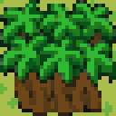 | Tropical Forest | forested | 2 | +50% | 3 Food, 1 Sugar, 2 Furs, 4 Lumber | Savannah |
| 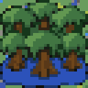 | Wetland Forest | forested | 3 | +50% | 2 Food, 1 Tobacco, 2 Furs, 4 Lumber, 1 Ore | Marsh |
| 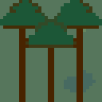 | Rain Forest | forested | 3 | +75% | 2 Food, 1 Sugar, 1 Furs, 4 Lumber, 1 Ore | Swamp |
|  | Arctic | ice | 2 | none | nothing |  |
|  | Ocean | water | 1 | none | 4 Fish with 0 to 5 of the 8 neighbours water, 2 Fish with 6 or 7, 1 Fish with all 8 |  |
|  | Sea Lane | water | 1 | none | 4 Fish with 0 to 5 of the 8 neighbours water, 2 Fish with 6 or 7, 1 Fish with all 8 |  |
| 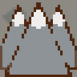 | Mountains | mountains | 3 | +150% | 4 Ore |  |
| 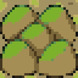 | Hills | hills | 2 | +100% | 2 Food, 4 Ore |  |

<!-- /table -->

### Ocean and the Sea Lane

Ocean is where ships sail and where fishermen work. Fish depends on how much water surrounds the square, so the best fishing is close to the shore. Fish is landed as food, and only a colony with Docks can work the water.

The Sea Lane runs down both edges of the map, well away from land. It is open sea like the rest, with the same fish, but it is also the way to Europe: a ship that sails into the Sea Lane can set out for the Old World (see [[Europe and Trade]]). Ships may sail only on the ocean that reaches the map's edge, not on inland lakes.

## Rivers, roads and plowing

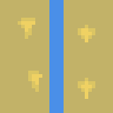 **Rivers** run from inland down to the sea; some are major rivers, drawn wider. 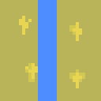 A river helps both moving and working. A land unit moving straight along a river (from one river square to the next, not diagonally) pays a third of a move. Every good a colonist brings in from a river square, if it gives any, is one higher (two higher for lumber, and for an expert at anything but food and fish), and a major river adds one more step when nothing else does. Furs gain before anything else: one on a river, two on a major river. A river also adds to the second product of a colony standing on it.

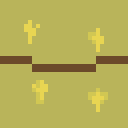 **Roads** are built by pioneers. Moving from one road square to another costs a third of a move; a colony counts as a road. A road adds one to the furs, lumber, ore and silver a colonist brings in from the square (two for lumber and for experts, and furs gain one more before anything else). It also opens bare silver: mountains with no silver deposit give one silver only with a road or to an expert silver miner.

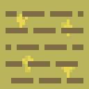 **Plowing** adds one to the food, sugar, tobacco and cotton the square gives, if it gives any. A colony's own square gains one food when plowed. Hills and mountains cannot be plowed, and a forest must be cleared first; clearing and plowing are two separate jobs. Clearing a forest also sends lumber to your nearest colony within three squares (more with a Lumber Mill, twice as much from a hardy pioneer), as much as its warehouse has room for.

A pioneer needs twenty tools for a job; they are used up when the job is done, not when it is begun. A pioneer left with fewer than twenty becomes a plain colonist. The turns each job takes are below, with a hardy pioneer's in brackets; the turn the order is given counts as the first.

<!-- table: pioneer-work -->

| Terrain | Road | Clear the forest | Plow |
| :--- | :--- | :--- | :--- |
| Tundra | 4 (2) |  | 6 (3) |
| Desert | 3 (1) |  | 5 (2) |
| Plains | 3 (1) |  | 5 (2) |
| Prairie | 3 (1) |  | 5 (2) |
| Grassland | 3 (1) |  | 5 (2) |
| Savannah | 3 (1) |  | 5 (2) |
| Marsh | 5 (2) |  | 7 (3) |
| Swamp | 7 (3) |  | 9 (4) |
| Boreal Forest | 4 (2) | 6 (3) | clear first |
| Scrub Forest | 4 (2) | 6 (3) | clear first |
| Mixed Forest | 4 (2) | 6 (3) | clear first |
| Broadleaf Forest | 4 (2) | 6 (3) | clear first |
| Conifer Forest | 4 (2) | 6 (3) | clear first |
| Tropical Forest | 6 (3) | 8 (4) | clear first |
| Wetland Forest | 6 (3) | 8 (4) | clear first |
| Rain Forest | 7 (3) | 9 (4) | clear first |
| Arctic | 4 (2) |  | 6 (3) |
| Mountains | 7 (3) |  | cannot be plowed |
| Hills | 4 (2) |  | cannot be plowed |

<!-- /table -->

## Moving across the map

A land unit pays the move cost of the square it enters, in moves (a third of a move along a road or straight along a river). Entering a square with a native settlement costs at most one move. A unit that has not moved yet this turn can always take one step, however dear; a unit that has used some of its moves may still try a step it cannot afford, and makes it with a chance that is smaller the fewer moves it has left; its turn ends either way. Every ship's step costs one move. Stepping from a ship onto land, or from land onto a ship, ends the unit's turn unless a colony is at one end.

## Resources

Some squares carry a special resource that makes them worth more. Each kind is found only on certain terrain. Most add to one or two goods, and more for the colonist who is an expert at that good; the three prime crops double the crop instead. The table gives what each adds to the bare square's figure. A resource adds even to a square that would otherwise give none of that good, except a fishery, which needs fish to begin with.

<!-- table: resources -->

|  | Resource | Found on | Adds |
| :--- | :--- | :--- | :--- |
| 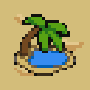 | Oasis | Desert, Scrub Forest | +2 Food (+4 for the expert) |
| 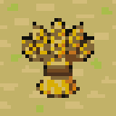 | Wheat | Plains | +2 Food (+4 for the expert) |
| 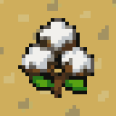 | Prime Cotton | Prairie | doubles Cotton |
| 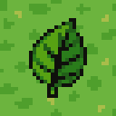 | Prime Tobacco | Grassland | doubles Tobacco |
| 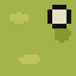 | Prime Sugar | Savannah | doubles Sugar |
| 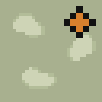 | Minerals | Tundra, Marsh, Swamp, Wetland Forest, Rain Forest | +3 Ore (+6 for the expert), +1 Silver (+2 for the expert) |
|  | Fishery | Ocean | +3 Fish (+6 for the expert) |
| 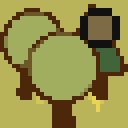 | Beaver | Mixed Forest | +3 Furs (+6 for the expert) |
| 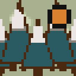 | Game | Boreal Forest, Broadleaf Forest | +2 Food (+4 for the expert), +2 Furs (+4 for the expert) |
| 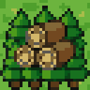 | Prime Timber | Conifer Forest, Tropical Forest | +4 Lumber (+8 for the expert) |
| 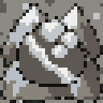 | Silver Deposit | Mountains | +3 Silver (+5 for the expert) |
| 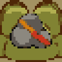 | Ore Deposit | Hills | +2 Ore (+4 for the expert) |

<!-- /table -->

No resource runs out: a mine can be worked for the whole game.

### The colony square

The square a colony stands on is worked by the colony itself, with no colonist, and it follows its own rule. It gives food: three on most ground, one on desert and scrub forest, two on hills, mountains and the other forests, none on arctic ice. Add two on the easiest level and one on the next; one if the square is plowed; two for an oasis, wheat or game; and the colony's Sons of Liberty bonus. It also gives a second product: the largest of sugar, tobacco, cotton, furs, ore and silver that the bare ground and its resource offer (never lumber), plus one on the easiest level, one or two for a river or a major river, and the Sons of Liberty bonus. Roads, experts and Tories make no difference to the colony square.

## Lost City Rumors

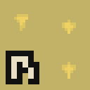 A round gold seal in the corner of a square is a Lost City Rumor. Move a unit onto it to find out what it is; the rumor is gone afterwards. A scout does better than other units, and a seasoned scout better still.

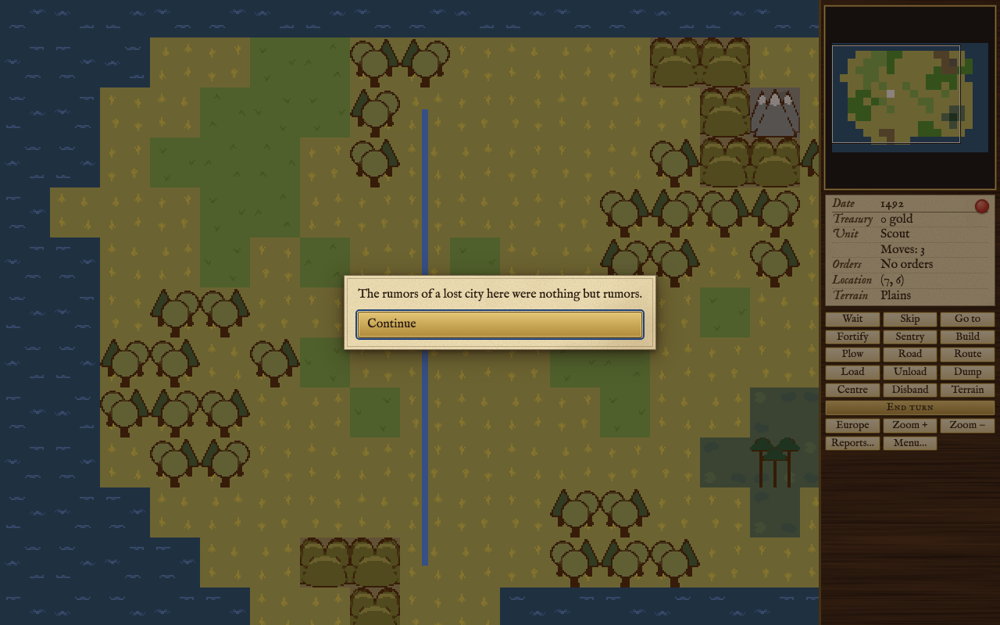

A rumor can turn out to be:

- **Nothing but rumors.**
- **Ruins** of a lost civilisation, with some gold.
- **A small friendly village** that gives you gold.
- **Survivors of a lost colony**: a free colonist joins you on the square.
- **Burial mounds**: you choose whether to dig. They may be empty, hold trinkets, or hold a treasure. If they are sacred to a nearby people, digging angers them whatever you find.
- **Holy shrines** of a people you have met: disturbing them angers that people.
- **A City of Cibola**: a treasure train. Found only on hills, mountains, desert or scrub forest, and only a few times in a game.
- **The Fountain of Youth**: eight colonists come from Europe, free, and you pick them. Found only on grassland, savannah, marsh or swamp, wooded or not, and not among the first few rumors explored. After you declare independence it can only be a City of Cibola, on the ground and within the count a City of Cibola needs.
- **The party vanishes**: the unit is lost. A scout is less likely to vanish, and a power with very few colonists and colonies never loses its party this way.

A scout of a power with Hernando de Soto among its Founding Fathers is luckier: it can find the Fountain of Youth on any ground and at any time, and now and then a City of Cibola on any ground; and when its first look turns up nothing, shrines or a vanished party, it looks again.

A random map has between ten and twenty-five rumors, more on a bigger land mass.

## Native land

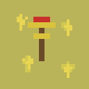 Much of the land belongs to the native peoples: the squares around each settlement are its people's land. The sidebar names it ("Sioux land", for instance) when the square is in view, and the colony screen marks such squares with a totem.

Once you have met a people, using their land costs something. Putting a colonist to work on a square of their land, or having a pioneer clear a forest or build a road there, brings a question: give up, pay their price (if you have the gold), or go ahead. Paying makes the square yours and settles the matter. For a colonist, going ahead takes the square anyway and angers them, the more so the nearer it is to their settlement. For a pioneer, going ahead only lets the work go on: the square stays theirs, and they are angered when the clearing, plowing or road is finished. Plowing open land and founding a colony are not asked about: a colony takes its own square, and that angers them too. The price depends on the difficulty level, the people's own advancement, how far the square is from the settlement and how much land that people has sold already; a square with a resource costs twice as much. One Founding Father makes every people's land free to use. See [[Native Peoples]].

## How maps are made

The map is 56 squares across and 70 down, with an edge of ice at the top and bottom and the Sea Lane down both sides.

**New World** makes a fresh random map for each game from a random number, the map's seed. The same seed always makes the same map, chart and all. Land is raised as one or more continents; mountain ridges run through it with hills beside them; the climate goes from tundra and boreal forest near the poles to savannah and rain forest at the middle; rivers run from inland to the sea; and resources, rumors and native settlements are spread over the land.

**Customize New World** makes a random map with four settings of your choice, each with three choices:

- **Land Mass** (Small, Normal, Large): how much of the map is land.
- **Land Form** (Archipelago, Normal, Large Continents): many small islands, or a few large masses.
- **Temperature** (Cool, Temperate, Warm): shifts the whole map toward the cold or the hot kinds of ground.
- **Climate** (Arid, Normal, Wet): shifts it toward the dry or the wet kinds of ground, and gives it less or more forest.

**America** is one fixed coastline of the two American continents, drawn for this game, with mountains where the great ranges are and each native people near its own home. Every square of it, its ground, hills, rivers, resources and rumors, is fixed, the same in every game. Customize does not apply to it.
