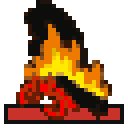

Every kind of unit, what it can do and the orders it takes.

Everything you move on the map is a unit: your colonists and the jobs they take on, your wagons and ships, and the soldiers of every side. This page lists them all, then explains each family, the orders a unit takes and how units move. How fights are decided is on [[Combat]].

## Every unit

Moves are whole squares of open land a turn. Attack is the unit's strength when it starts a fight, defence its strength when it is attacked. Holds are cargo spaces: each takes 100 of one good, or one person. A unit with an attack of 0 cannot start a fight.

<!-- table: units -->

|  | Unit | Land or sea | Moves | Attack | Defence | Holds | How it is got |
| :--- | :--- | :--- | :--- | :--- | :--- | :--- | :--- |
|  | Colonist | Land | 1 | 0 | 1 | 0 | Recruited or trained in Europe, or born in a colony |
|  | Soldier | Land | 1 | 2 | 2 | 0 | Equipped: a colonist given 50 muskets |
|  | Pioneer | Land | 1 | 0 | 1 | 0 | Equipped: a colonist given 20 to 100 tools |
|  | Missionary | Land | 2 | 0 | 1 | 0 | Equipped: a colonist blessed in a colony with a Church or Cathedral, or on the docks in Europe |
|  | Dragoon | Land | 4 | 3 | 3 | 0 | Equipped: a colonist given 50 muskets and 50 horses |
|  | Scout | Land | 4 | 1 | 1 | 0 | Equipped: a colonist given 50 horses |
|  | King's Regular | Land | 1 | 5 | 5 | 0 | The Crown's only |
|  | Continental Cavalry | Land | 4 | 5 | 5 | 0 | After the Declaration: mustered, promoted or sent by a foreign power |
|  | King's Cavalry | Land | 4 | 6 | 6 | 0 | The Crown's only |
|  | Continental Army | Land | 1 | 4 | 4 | 0 | After the Declaration: mustered, promoted or sent by a foreign power |
|  | Treasure Train | Land | 1 | 0 | 0 | 0 | Found: a rumour, burial mounds or a destroyed settlement |
|  | Artillery | Land | 1 | 7 | 5 | 0 | Built (needs an Armory), or bought in Europe for 500 (+100 for each one bought) |
|  | Damaged Artillery | Land | 1 | 5 | 3 | 0 | Artillery that has lost a fight |
|  | Wagon Train | Land | 2 | 0 | 1 | 2 | Built |
|  | Caravel | Sea | 4 | 0 | 2 | 2 | Built (needs a Shipyard), or bought in Europe for 1000 |
|  | Merchantman | Sea | 5 | 0 | 6 | 4 | Built (needs a Shipyard), or bought in Europe for 2000 |
|  | Galleon | Sea | 6 | 0 | 10 | 6 | Built (needs a Shipyard), or bought in Europe for 3000 |
|  | Privateer | Sea | 8 | 8 | 8 | 2 | Built (needs a Shipyard), or bought in Europe for 2000 |
|  | Frigate | Sea | 6 | 16 | 16 | 4 | Built (needs a Shipyard), or bought in Europe for 5000 |
|  | Man-O-War | Sea | 5 | 24 | 24 | 6 | The Crown's only |
|  | Braves | Land | 1 | 1 | 1 | 0 | The native peoples' only |
|  | Armed Braves | Land | 1 | 2 | 2 | 0 | The native peoples' only |
|  | Mounted Braves | Land | 4 | 2 | 2 | 0 | The native peoples' only |
|  | Mounted Warriors | Land | 4 | 3 | 3 | 0 | The native peoples' only |

<!-- /table -->

## Colonists and professions

 A colonist is a person. Inside a colony he works a square of land or a trade in a building; outside it he can be given equipment and a task, and lay it down again in any of your colonies. He comes over from Europe as a recruit or after training, or is born in a colony that has stored enough food (see [[Colonies]] and [[Europe and Trade]]).

What a colonist is good at is his profession. An ordinary free colonist can do any work. Indentured servants are as good as anyone in the fields but poor at a craft; petty criminals are fit for field work and little else; an Indian convert is better than a colonist on the land and at sea, and poor at a craft. Schooling, or winning a battle as a soldier, moves a criminal up to servant and a servant up to free colonist.

An expert is a colonist with a skill. At his own work he does about twice what a free colonist does; anywhere else he is a free colonist. There are three ways to get one: train him in Europe, teach a free colonist in a school (a Schoolhouse, College or University, each able to teach the skills of its own level and below), or have a native settlement teach him. A free colonist, servant or criminal who works as a planter or a fur trapper may also learn the trade by doing it, while you have no expert of that kind anywhere.

<!-- table: professions -->

| Skill | Expert at | Taught in a school | Natives teach it |
| :--- | :--- | :--- | :--- |
| Expert Farmer | Food: 2 more a square | Schoolhouse | Yes |
| Master Sugar Planter | Sugar: twice as much a square | College | Yes |
| Master Tobacco Planter | Tobacco: twice as much a square | College | Yes |
| Master Cotton Planter | Cotton: twice as much a square | College | Yes |
| Expert Fur Trapper | Furs: twice as much a square | Schoolhouse | Yes |
| Expert Lumberjack | Lumber: twice as much a square | Schoolhouse | No |
| Expert Ore Miner | Ore: twice as much a square | Schoolhouse | Yes |
| Expert Silver Miner | Silver: twice as much a square | Schoolhouse | Yes |
| Expert Fisherman | Fish: 2 more a square | Schoolhouse | Yes |
| Master Distiller | Rum from sugar: twice as much | College | No |
| Master Tobacconist | Cigars from tobacco: twice as much | College | No |
| Master Weaver | Cloth from cotton: twice as much | College | No |
| Master Fur Trader | Coats from furs: twice as much | College | No |
| Master Carpenter | Hammers from lumber: 6 a turn where a colonist makes 3 | Schoolhouse | No |
| Master Blacksmith | Tools from ore: twice as much | College | No |
| Master Gunsmith | Muskets from tools: twice as much | College | No |
| Firebrand Preacher | Crosses: 6 a turn where a colonist makes 3 | University | No |
| Elder Statesman | Liberty Bells: twice as much | University | No |
| Hardy Pioneer | Pioneer work, in half the turns | Schoolhouse | No |
| Veteran Soldier | Fighting as a soldier or dragoon, at +50% | College | No |
| Seasoned Scout | Scouting: safer with chiefs and at rumours, caught less often in a colony | Schoolhouse | Yes |
| Jesuit Missionary | Missions: founds expert missions, which bring more converts | University | No |

<!-- /table -->

A colonist who is an expert at the wrong job can have his specialty cleared on the colony screen, making him a free colonist again.

## Pioneers

 A pioneer is a colonist carrying tools. He clears forest, plows open land and builds roads. Each job takes a number of turns that depends on the ground, and uses up twenty tools when it is finished. A pioneer carries tools in lots of twenty, up to a hundred; one who runs out becomes a plain colonist again. A Hardy Pioneer does every job in half the turns, and clearing a forest near a colony sends its lumber there. The turns for each kind of ground are on [[The Map]]. If the land belongs to a native people they may ask you to pay for it first.

## Scouts

 A scout is a colonist on horseback: fifty horses make one. He moves four squares a turn, sees two squares around instead of one, and is the best unit to explore Lost City Rumours. Taken into a native settlement he can speak with the chief, who may share tales of the land around, give gold, or make him a Seasoned Scout; a scout is sometimes killed for his trouble when the tribe is angry. Beside a foreign colony he can try to slip in and look it over. A seasoned scout does all of this better and more safely. A scout who loses a fight is lost.

## Missionaries

 A missionary is a colonist blessed in a colony with a church, or on the docks in Europe. He moves two squares a turn. Taken into a native settlement whose tribe has a treaty with you, he founds a mission there: the mission calms the settlement and now and then sends you a convert. A Jesuit Missionary founds an expert mission, which brings converts more often. A missionary can also denounce another power's mission, or pay the tribe to turn against another power. See [[Native Peoples]].

## Soldiers and dragoons

  A soldier is a colonist with fifty muskets; a dragoon has fifty muskets and fifty horses. A dragoon moves four squares a turn and hits harder. You arm a colonist in a colony, from the orders of a unit standing on the colony's square on the colony screen, using muskets and horses from the colony's store; or on the docks in Europe, where they are bought for him. Lay the equipment down and he is a colonist again, and the goods go back into the colony's store.

When a dragoon loses a fight he loses his horses and becomes a soldier; a soldier who loses becomes a colonist (a Jesuit Missionary under arms becomes a missionary again). The goods are gone. A Veteran Soldier fights half again as well as a colonist with the same muskets, whether he is on foot or mounted.

**Promotion.** A soldier or dragoon who wins a fight may be raised a step: a petty criminal to indentured servant, a servant to free colonist, and a free colonist to Veteran Soldier. The harder the fight, the likelier the promotion; with George Washington in the Congress it is certain. After a Declaration of Independence your veterans who win may join the Continental Army.

## Wagon trains and treasure trains

 A wagon train carries two holds of cargo overland, between your colonies and to native settlements to trade. It is built in a colony and needs no building to make it, but you may keep only as many wagon trains as you have colonies. It cannot board a ship, cannot fight, and is captured if a European unit beats it.

 A treasure train is gold found in the New World: in a Lost City Rumour, in burial mounds, or among the ruins of a destroyed settlement. It moves one square a turn, cannot fight and is captured if beaten. It fills six holds, so of your ships only a Galleon can take one aboard. There are three ways to turn one into gold. Bring it into a colony of yours on the open sea (a lake will not do) while you own no galleon, and the Crown offers to carry it home for a share (see [[The Crown and Independence]]); with Hernan Cortes in Congress the offer is made even if you have a galleon. Load it aboard your own galleon and sail to Europe, and it pays its whole value the moment the ship makes port, with nothing kept back. After the Declaration, agents buy a treasure in any colony of yours, coastal or inland, for its whole value. The offer is put to you when the train enters the colony; if you decline, the train waits there, and the colony's orders menu offers the same again. While you own a galleon (and lack Cortes) the menu's entry says the Crown will not carry it.

## Ships

 Ships carry goods and people across the sea and to and from Europe. Each hold takes 100 of one good or one land unit; wagon trains and other ships cannot be carried. The Caravel, Merchantman and Galleon are cargo ships and cannot attack. The Privateer and Frigate carry cargo and fight; the Man-O-War is the Crown's. Ships are bought in Europe or built in a colony with a Shipyard. Galleons, privateers and frigates see two squares around.

**Carrying units.** A land unit goes aboard by stepping onto a ship's square, or by being on sentry on a ship's square when the ship moves off, while there is room. Stepping between land and a ship ends the unit's turn unless a colony is at one end. When a ship enters a colony its passengers wake but stay aboard; send them ashore with the Go ashore order on the colony screen, or move them off. At sea beside empty land you can make landfall (below).

**Repair.** A ship that loses a fight is sunk or crippled. A crippled ship loses everything aboard and is taken to your nearest colony with a Drydock, or to Europe if you have none; it cannot move until it is repaired. The longest the repairs take is below; a ship beaten by a weaker one is ready sooner. During the War of Independence, with Europe closed, a crippled ship with no drydock to go to sinks.

<!-- table: ship-repairs -->

| Ship | Turns in Europe | Turns in a Drydock |
| :--- | :--- | :--- |
| Caravel | 2 | 1 |
| Merchantman | 6 | 3 |
| Galleon | 10 | 5 |
| Privateer | 8 | 4 |
| Frigate | 12 | 6 |
| Man-O-War | 16 | 8 |

<!-- /table -->

## Artillery

 Artillery is the strongest attacker you can build: a colony with an Armory can make it, and Europe sells it at a price that rises with each piece bought. It is at its best in a colony and weak in the open, where it fights at a quarter of its strength, attacking or defending, unless the European unit defending is fortifying or fortified. Artillery in a colony attacked by natives defends at double. Beaten once it becomes  Damaged Artillery; beaten again it is lost.

## The native units

    Each native settlement keeps a band of braves. Braves with muskets become Armed Braves, braves with horses Mounted Braves, and with both Mounted Warriors. Their people get muskets and horses by trade, as gifts and demands, and by taking them from your units in a fight. Braves visit your colonies, trade, ask for food, make demands and, when their people are angry, attack. You cannot make or take these units. See [[Native Peoples]].

## The Crown's units

   The King's Regulars, King's Cavalry and the Man-O-War belong to the Crown alone. They arrive with the Expeditionary Force when you declare independence, along with the Crown's artillery. Your answer is the  Continental Army and  Continental Cavalry: veterans in colonies that back the cause muster into them when war begins, and veterans who win battles are promoted into them. When beaten, Continental Cavalry becomes Continental Army, and Continental Army becomes a colonist. See [[The Crown and Independence]].

## Orders

A unit with moves left and no orders asks for them: it is the active unit, and its frame blinks on the map. The game goes round your units one by one; when none is left waiting, press Enter to end the turn. Every order is on a key and on a button in the sidebar. The letter on a unit's piece shows its orders: S sentry, F fortified, G going somewhere, P plowing or clearing, R building a road, T on a trade route, X exploring.

| Key | Order | What it does |
| :--- | :--- | :--- |
| Arrows or numpad | Move | Move one square. Moving onto a foreign unit or settlement attacks it, or enters it |
| F | Fortify | The unit digs in. It ends its turn, is Fortified from the next, and is not asked for orders again until woken |
| S | Sentry | The unit is passed over until a foreign unit comes alongside, or, aboard ship, until the ship reaches a colony |
| W | Wait | Go on to the next unit and come back to this one later in the turn |
| Space | Skip | No orders this turn |
| A | Activate | Clear the orders of the unit under the cursor, or of the active unit |
| G | Go to | Choose one of your colonies, Europe for a ship that can reach the Sea Lane, or any square; the unit goes there over as many turns as it takes |
| Shift-E | Explore | A scout or a ship only. Each turn it heads for the nearest place that shows it land or sea you have not seen, over squares you know; a scout enters every Lost City Rumour it sees and speaks with every chief nobody has spoken with whose people are not angry with you. You see what it found as if you had moved it there. When nothing in reach is left, it wakes and the log says so |
| L | Load | Load the most valuable cargo in this colony |
| U | Unload | Unload cargo into this colony |
| O | Dump | Throw cargo overboard (outside a colony) |
| T | Trade route | Put a ship or wagon train on one of your trade routes; Alt+T makes and edits routes |
| Shift-D | Disband | Remove the unit from the game for good; the game asks first |
| B | Build or join colony | Found a colony here, or join the colony on this square |
| P | Clear or plow | A pioneer clears the forest here, or plows open land |
| R | Road | A pioneer builds a road here |

You can also click a unit to make it active, click beside it to move it, or drag it to where you want it to go. The full list of keys is on [[Controls]].

**Trade routes.** A trade route is a list of stops, with what to load and unload at each. A ship or wagon train put on one carries it out turn after turn without further orders; a sea route may call at Europe.

**Disband.** A colonist is nearly always worth more at work in a colony than disbanded; the order is for units that cost you more than they bring.

## Moving

Each unit has its moves afresh every turn, and the game counts them in thirds. Stepping onto a square costs its terrain's move cost in whole moves: one for plains or grassland, two for most forest, marsh, swamp and hills, three for mountains and the wettest forests. [[The Map]] describes each kind of ground. A step along a road costs a third of a move when both squares have one (a colony counts as a road), and so does a step along a river, if it is not diagonal. Entering a native settlement never costs more than one move, but a visit there (trading, speaking with the chief, founding a mission) ends the unit's turn.

**The third-of-a-move rule.** A unit that has not moved yet this turn can always make its step, however rough the ground. A unit that has moved, and has too little left for the next square, may still make it: the chance is what it has left over what the step costs. Either way its turn is then over.

**Ships** spend one move per square of ocean, and enter only the open sea and your own colonies. Entering a colony ends a ship's or wagon train's turn and wakes its passengers. With Ferdinand Magellan in the Congress, every ship moves one square farther.

**Boarding and landfall.** Stepping between land and a ship ends a unit's turn, unless a colony is at one end: stepping from a colony onto a ship lying alongside costs one move. If you steer a ship onto empty land and a passenger has moves left, you are offered landfall: the passengers wake and can each step ashore. A unit aboard ship cannot step onto a square held by another power.

**Stacks.** Several units can stand on one square. The map shows only the top one, drawn with a second outline behind it so you can tell there are more; the active unit is always the one on top. Click a stack to choose which unit to take. In a colony only the active unit is drawn, so the colony itself stays visible.

## Sailing to Europe and back

Europe lies off the map. The Sea Lanes are the bands of deep water along the map's sides, and a ship reaches Europe from them: when a ship steps east from one Sea Lane square to another, or off the east or west edge of the map, it asks whether to sail for Europe. The Go To order offers Europe first to any ship whose waters reach a Sea Lane; the ship heads for the nearest one and sails without asking.

The crossing takes two turns each way, from either edge. Now and then it takes a turn longer, when you have three ships or more and do not have Magellan. A ship at sea can be turned back, which takes two turns. Coming back, a ship appears on the square it left from, or the nearest free Sea Lane square. During the War of Independence, Europe is closed. What you do there is on [[Europe and Trade]].
